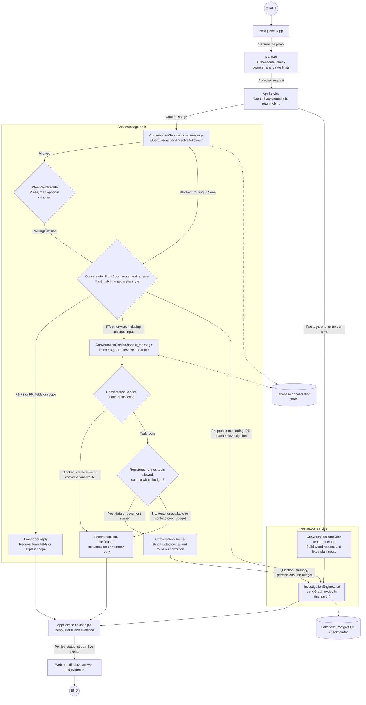
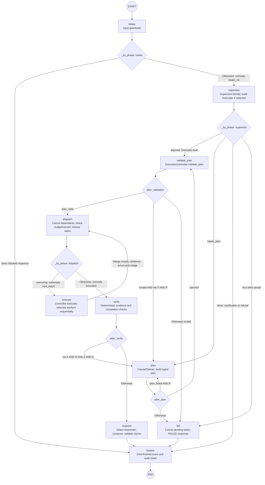
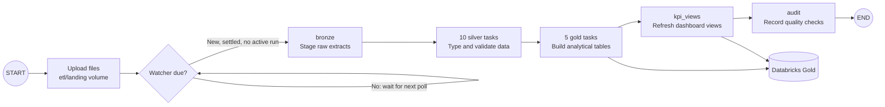
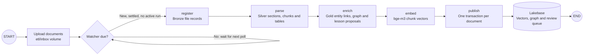
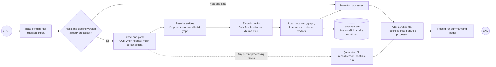

# WBG Procurement Intelligence

An agentic AI analyst for World Bank procurement. You ask a question in plain language. The assistant finds the
answer in the right places: the Gold data tables, the project reports and the prediction models. It returns one
answer, and every statement in it cites its source: a table row, a document page or a model.

| | |
| --- | --- |
| Status | Working proof of concept (demo-ready) |
| Scope | 2,000 World Bank projects (data); 35 projects in 5 countries (documents) |
| Start it | `uv run wbg-api` and `uv run wbg-web`, then open <http://localhost:3000> ([HOW_TO_RUN.md](HOW_TO_RUN.md)) |
| Plain-English guide | [docs/PROJECT_OVERVIEW.md](docs/PROJECT_OVERVIEW.md) |

---

## 1. The project

Procurement staff have to combine figures from many tables with what long project reports say. Finding a reliable
answer can take hours. General chatbots are fast, but they cannot show where an answer came from. This platform aims
to be fast **and** checkable. It answers only from World Bank data and documents. Claims without evidence are removed
before the answer is shown.

| Capability | What the user gets |
| --- | --- |
| Chat | Answers from the data, from the documents, or from both, with an evidence panel and live progress |
| TableLens | Exact figures read from the right table inside a PDF (10 pilot reports) |
| Package assessment | Predicted tender duration, amendment risk and re-bid risk, each with its drivers |
| Check tender | A tender draft compared with similar past packages, with the benchmark behind each flag |
| Project watch | Milestones, slippage and early warnings for a running project |
| Plan a new project | A cited planning brief built from similar past projects and approved lessons |
| Lesson cards | Lessons taken from completion reports and reviews; used only after a reviewer approves them |
| Dashboards | Headline KPIs from the Gold views; they update when new data is loaded |
| Feedback | Ratings and corrections. A correction is kept for its user, and shared only after review |
| Accounts | Sign-up, sign-in and recovery-code password reset. Each user sees only their own work |

Project watch, Check tender and lesson cards are rule-based. They work without Claude and give the same result every
time.

---

## 2. Architecture and LangGraph workflow

These diagrams describe the current implementation in [runtime.py](orchestrator/wbg_orchestrator/runtime.py),
[graph.py](orchestrator/wbg_orchestrator/graph.py) and the linked source files below. They use GitHub's native
Mermaid rendering. Double-bordered boxes represent nested workflows or workers, not necessarily another LangGraph.

### 2.1 Request flow and service boundaries

There are **three distinct routing layers**: `IntentRouter` classifies the message,
`ConversationFrontDoor` chooses how the application handles that classification, and `Supervisor.decide`
chooses an investigation plan. LangGraph's edge routers then control execution of that plan.



`route_message` is a read-only routing probe; `handle_message` performs its own guard, follow-up resolution and
intent routing when the front door delegates to it. A blocked probe returns `None` and falls through to that
service, which records the blocked turn. Form requests call feature methods directly and do not pass through
`IntentRouter`. Every investigation still passes through the graph's `intake` and `supervise` nodes.

**Router reference and conditions**

| Router / selector | Inputs and ordered conditions | Outcome |
| --- | --- | --- |
| [IntentRouter.route](conversation/routing/router.py) | Rules first: empty/tool directive → clarification; conversational text → conversation; topic reset → reset/task; evidence recheck → previous task; recall → memory; explanation of previous answer → conversation; strong definition without entities → conversation; explicit task signals → task or mixed-intent clarification; follow-up → previous task; unresolved reference → clarification; weak definition without entities → conversation | One `RoutingDecision`. An unresolved task referent is finally forced to clarification unless this is a reset or evidence recheck |
| `IntentRouter._classify` | Runs only if no rule matched. Classifier absent/error, score below **0.75**, or classifier route `clarification` → clarification | Otherwise accepts classifier route. Claude classifier is wired only for live operation; this is intent classification, not planning |
| [ConversationFrontDoor._route_and_answer](orchestrator/wbg_orchestrator/conversation_bridge.py) | Applies **F1–F7 below in order**, using the probe's decision, message text and saved planning context | Direct reply, feature investigation, combined investigation, or `ConversationService` |
| [ConversationService.handle_message](conversation/service.py) | Blocked guard → blocked reply; clarification route/unresolved task → clarify; conversational routes → conversation responder; otherwise → registered task runner | Runtime registers `ConversationRunner` for `structured_data` and `document_rag`; an unregistered task route returns `route_unavailable` |
| [Supervisor.decide](orchestrator/wbg_orchestrator/supervisor.py) | Typed feature inputs take priority; otherwise checks tool directives, available/authorized routes, complexity and route count | `fast`, `package`, `brief`, `monitor`, `tender`, `plan`, `clarify` or `refuse`; details in Section 2.2 |
| [LangGraph edge routers](orchestrator/wbg_orchestrator/graph.py) | `_by_phase`, `after_plan`, `after_validation`, `after_verify` read the node's updated state | Choose the next graph node; exact conditions below |

The front-door rules are first-match-wins, and F1–F6 require a non-`None` routing decision:

| Rule | Condition | Component called / result |
| --- | --- | --- |
| F1 | Route is `ml_prediction` | `_ask_for_fields`: request package assessment fields; no investigation |
| F2 | Route is `procurement_planning` | `_ask_for_fields`: request Planning Brief fields; no investigation |
| F3 | Text matches `TENDER_REQUEST` | `_ask_for_fields`: request tender form fields; no investigation |
| F4 | `monitoring_project(text)` identifies a project monitoring request | `watch_project`: typed monitoring investigation |
| F5 | Reason is in `UNCLEAR`, and text mentions neither the procurement domain nor recognized entities | `_scope_reply`: no investigation |
| F6 | `allow_combined` and either exactly mixed `structured_data` + `document_rag` signals or a reason in `UNCLEAR`; **or** saved planning context and `_follows_brief(routing)` | `_open_investigation`: `mode="investigation"`, authorized data/document routes and saved context |
| F7 | None of F1–F6 matched | `ConversationService.handle_message`; single data/document tasks enter the graph via `ConversationRunner` |

`UNCLEAR` is exactly `no_clear_intent`, `classifier_low_score`, or `classifier_error`.
`_follows_brief` accepts a task route or a reason in `UNCLEAR` or `ambiguous_referent`.
`allow_combined=True` is the default; the saved-brief branch is independent of that flag.

**Components used by the investigation**

The execution controller selects a worker by `AgentTask.worker`; it does not ask an LLM to route each execution.
The plan already names the worker, operation and dependencies. Wiring is in
[runtime.py](orchestrator/wbg_orchestrator/runtime.py).

| Component | Responsibility and actual dependency |
| --- | --- |
| `StructuredDataWorker` | Calls `NlToSqlWorkflow`: registry context → Claude SQL → SQL validation → optional read-only execution through structured-data tools |
| `DocumentIntelligenceWorker` | Document retrieval and cited answers, including TableLens and uploaded-document search; local bge-m3/BM25 retrieval and Lakebase stores |
| `PredictionWorker` | Fixed Gold lookups through the tool gateway and frozen scikit-learn duration/amendment/re-bid models |
| `PlanningWorker` | Similar-project matching, market benchmarks and governance context; Gold lookups plus document similarity |
| `TenderDesignWorker` | Rule-based checks against historical Gold benchmarks and supplied tender fields |
| `MonitoringWorker` | Deterministic milestone/slippage analysis from project monitoring inputs |
| `LessonsWorker` | Retrieves approved lesson cards from the Lakebase lesson store |
| Structured Data MCP server | Default separate-process tool boundary; validates read-only SQL against access policy before Databricks Gold queries. `WBG_TOOL_TRANSPORT=in_process` is also implemented |
| Claude through Portkey | Optional intent classification/conversation, planning, SQL generation and answer generation where required; enabled with `--live` |
| Lakebase PostgreSQL + pgvector | Conversation/account/workspace/feedback/lesson data, document vectors and graph, plus isolated investigation checkpoints |
| Databricks SQL warehouse | Gold analytical tables and KPI views. Dashboard API queries bypass the investigation workflow |
| Observability | JSON execution/audit logs and optional Logfire traces; LangSmith and offline sets evaluate behavior separately |

### 2.2 Core investigation workflow

Rectangles are the **10 registered LangGraph nodes**. Diamonds are their edge routers, not extra nodes.
The graph below contains only control-flow edges; worker/model calls and checkpoint writes occur inside nodes
or the engine, and are documented separately. `plan` re-entry is replanning; provider retries remain inside
`_model_call` and are not graph self-loops.



The short conditions in the diagram correspond exactly to the routing predicates:

| Condition | Meaning in code |
| --- | --- |
| `R` — replanning allowed | `state.replans < request.budget.max_replans`; default allowance is 1 |
| `F` — fixed plan | `plan.produced_by == "fast_path"`; includes the simple one-task plan **and** package/brief/monitor/tender fixed plans |
| `Z` — zero verified evidence | `VerificationReport.verified_evidence_count == 0` |
| `N` — required task lacked evidence | At least one `plan.completion.required_task_ids` member has an error with category `no_evidence` in the accumulated error ledger |

`after_plan` tests `planned` first; only `plan_failed` can re-enter `plan` under `R`. `plan_failed_final`
(budget, breaker, provider or unexpected failure) goes to `fail`. `after_validation` tests `plan_valid` first.
`after_verify` returns `respond` immediately for `F`, exhausted replans, or any verified evidence; only the
remaining zero-evidence case checks `N`. `dispatch` does **not** route cancellation to `fail`: it empties the batch
and proceeds to evidence verification. The controller considers dependencies usable only when `succeeded` or
`partial`; reused results are marked `skipped`, which is not in `USABLE_TASK_STATES`.

**Supervisor decision order** — [Supervisor.decide](orchestrator/wbg_orchestrator/supervisor.py) is deterministic;
it does not call Claude. The first matching condition wins.

| Priority | Condition | Mode and next step |
| --- | --- | --- |
| 1 | `request.tender` is present | `tender` → build `tender_plan` → `validate_plan` |
| 2 | `request.package` is present | `package` → build `package_plan` → `validate_plan` |
| 3 | `request.planning` is present | `brief` → build `brief_plan` → `validate_plan` |
| 4 | `request.monitor_project` is present | `monitor` → build `monitor_plan` → `validate_plan` |
| 5 | Text tries to select tools/agents | `refuse` → failed response → `finalize` |
| 6 | Prediction/planning signals exist without any data/document signal | `refuse`: chat wording alone cannot supply the required structured feature fields |
| 7 | Inferred data/document routes plus `route_hint` include a route outside authorization | `refuse` → `finalize`; permissions are never widened |
| 8 | `mode == "investigation"`, or more than one route, or complex wording while `mode != "fast"` | `plan` → `needs_plan` → ClaudePlanner |
| 9 | Exactly one route remains | `fast` → build one-task `fast_path_plan` → `validate_plan` |
| 10 | No route remains | `clarify` → ask data versus documents → `finalize` |

Each typed-feature branch also checks authorization: package needs `ml_prediction`; brief, tender and monitoring
need `procurement_planning`. A failed feature authorization check returns `refuse` instead of a fixed plan.
Complex wording is the `COMPLEX` regex (for example “investigate”, “explain why”, “step by step” and “cross-check”).
For a fast structured-data plan, execution is requested only when `execute_requested=True`; the controller also
rechecks authorization and budgets before running a task.

**Routing and termination.**

- `supervise` builds a fixed plan for structured package, planning, tender or monitoring requests. For ordinary
  questions, one authorized route gets a single-task fast plan; explicit investigation mode, both routes or complex
  wording selects the planner. `mode="fast"` overrides complex wording, but not the need for both routes.
  No clear route asks for clarification; unauthorized routes and tool directives are refused.
- `after_plan` retries malformed or rejected plans only while `replans < max_replans`. Budget, open-circuit,
  provider and unexpected planner failures go directly to `fail`. Invalid fixed plans (`produced_by="fast_path"`)
  never replan. Other invalid plans may replan within the same allowance.
- `dispatch` cancels pending dependants of failed, blocked or cancelled tasks. Ready tasks require usable dependency
  results. A budget stop or user cancellation cancels remaining pending tasks and continues to `verify`, allowing
  evidence already obtained to be reported. `execute` iterates the selected batch **synchronously**; parallel task
  execution is not implemented, even though the state contract accepts a larger `max_parallel`.
- `after_verify` replans only when there is **zero verified evidence**, a required task has a `no_evidence` error,
  the plan is not `fast_path`, and allowance remains. Otherwise it responds, including partial results and gaps.
- `respond` uses Claude by default. Tender requests and plans containing only monitoring/lessons workers use
  `DeterministicResponseGenerator`. Model or budget failures produce a validated response without generated claims;
  there is no alternate-provider fallback. Unsupported claims are removed. Status can be `answered`, `partial`,
  `insufficient_evidence` or `conflicting_evidence`; worker clarification can replace a response with no claims.
  Every normal branch ends at `finalize → END`, including blocked, clarification and failed responses.

**Limits and retry behavior.** Defaults come from
[InvestigationBudget](orchestrator/wbg_orchestrator/contracts.py),
[planner.py](orchestrator/wbg_orchestrator/planner.py) and
[controller.py](orchestrator/wbg_orchestrator/controller.py):

| Scope | Implemented limit or behavior |
| --- | --- |
| Default investigation | 6 tasks, dependency depth 3, batch size 1, 1 replan; 60 seconds per task and 120 seconds execution budget |
| Default usage budget | 8 LLM calls, 80,000 input tokens, 12,000 output tokens and 3 counted executions; cost cap is optional and needs configured prices |
| Planning Brief override | 10 tasks, 3 LLM calls, 150 seconds per task, 420 seconds execution budget, 0 replans; `max_executions=0` (its fixed Gold lookups are not execution-gated generated-SQL tasks) |
| Worker attempts | `answer_data_question` and `answer_document_question`: 1 attempt. Other built-plan operations: 2 attempts, bounded by the request budget. Only raised transient worker errors/timeouts retry; returned worker failures do not |
| Worker retry delay | Exponential backoff starting at 0.25 seconds, factor 2, capped at 2 seconds; the default two attempts allow one retry |
| Worker circuit breaker | Opens after 3 failures within 60 seconds; initial cooldown 30 seconds, maximum cooldown 300 seconds |
| Planner/answer provider retry | 2 total attempts for transient `LlmError`; pause is `min(retry_after_seconds or 2, 2)` seconds. Invalid output and authentication errors do not use this retry |
| Nested NL-to-SQL workflow | At most 1 SQL correction for recoverable validation errors; no automatic LLM retry, and at most 1 Databricks execution per workflow run |

Claude is accessed through Portkey; the model is configured by `PORTKEY_CLAUDE_MODEL` and must be a Claude model
under `@wbg-anthropic/`. The exact deployed model is environment-dependent, not hardcoded here. See
[settings.py](structured_agent/nl2sql/settings.py) and [workflow.py](structured_agent/nl2sql/workflow.py).
Task timeouts signal cooperative cancellation; they do not kill the worker thread. Reused successful results are
marked `skipped` by idempotency key, avoiding repeat work after replanning.

### 2.3 Node reference

| Node | File | What it does |
| --- | --- | --- |
| `intake` | [graph.py](orchestrator/wbg_orchestrator/graph.py) | Checks input guardrails; produces a blocked response or allows supervision |
| `supervise` | [graph.py](orchestrator/wbg_orchestrator/graph.py), [supervisor.py](orchestrator/wbg_orchestrator/supervisor.py) | Selects a fixed plan, model planning, clarification or refusal |
| `plan` | [graph.py](orchestrator/wbg_orchestrator/graph.py), [planner.py](orchestrator/wbg_orchestrator/planner.py) | Calls ClaudePlanner with memory, previous plan and failure codes; builds a typed plan |
| `validate_plan` | [controller.py](orchestrator/wbg_orchestrator/controller.py) | Checks identity, authorization, operations, evidence requirements, task limits and acyclic dependencies |
| `dispatch` | [graph.py](orchestrator/wbg_orchestrator/graph.py), [controller.py](orchestrator/wbg_orchestrator/controller.py) | Cancels unusable dependants, checks stop conditions and selects ready tasks |
| `execute` | [graph.py](orchestrator/wbg_orchestrator/graph.py), [controller.py](orchestrator/wbg_orchestrator/controller.py) | Calls workers under tickets, budgets, deadlines and breakers; collects attempt results and evidence |
| `verify` | [verification.py](orchestrator/wbg_orchestrator/verification.py) | Deterministically checks evidence, conflicts and unmet completion requirements |
| `respond` | [graph.py](orchestrator/wbg_orchestrator/graph.py), [response.py](orchestrator/wbg_orchestrator/response.py) | Composes the answer, validates claims, masks personal data and assigns response status |
| `fail` | [graph.py](orchestrator/wbg_orchestrator/graph.py) | Cancels pending tasks and returns a failure with recorded error codes |
| `finalize` | [graph.py](orchestrator/wbg_orchestrator/graph.py) | Emits completion events and audit totals; sets phase to `finished` |

All 10 node wrappers are defined in `graph.py`; the table also links the modules they delegate to. The controller
registers seven workers in [runtime.py](orchestrator/wbg_orchestrator/runtime.py):
[structured](orchestrator/wbg_orchestrator/workers/structured.py),
[document](orchestrator/wbg_orchestrator/workers/document.py),
[prediction](orchestrator/wbg_orchestrator/workers/prediction.py),
[planning](orchestrator/wbg_orchestrator/workers/planning.py),
[monitoring](orchestrator/wbg_orchestrator/workers/monitoring.py),
[tender](orchestrator/wbg_orchestrator/workers/tender.py) and
[lessons](orchestrator/wbg_orchestrator/workers/lessons.py).

### 2.4 Shared investigation state

[InvestigationState](orchestrator/wbg_orchestrator/state.py) is JSON-serializable. Nodes return updates which reducers
merge; they do not mutate the shared state. The runtime uses a PostgreSQL checkpointer; the engine defaults to
in-memory checkpoints when none is supplied.

| Field | Purpose |
| --- | --- |
| `request` | Initial question, trusted owner, authorization, feature payload and budgets |
| `phase` | Latest phase used by routing decisions |
| `supervisor` | Latest supervisor decision and reasons |
| `plan` | Current typed plan |
| `plans` | Append-only history keyed by plan ID |
| `plan_errors` | Append-only errors for rejected plans |
| `replans` | Additive count used to bound replanning |
| `task_states` | Per-task lifecycle; reducer permits only forward transitions |
| `next_batch` | Latest list of task IDs selected by dispatch |
| `results` | Immutable attempt records keyed by task ID and attempt |
| `evidence` | Append-only evidence ledger keyed by evidence ID |
| `errors` | Append-only execution and workflow errors |
| `approvals`, `decisions` | Declared state fields; no approval node or active approval routing in this graph |
| `usage` | Additive call, token, execution, task, retry, elapsed-time and cost counters |
| `verification` | Latest evidence/completion report |
| `response` | Latest validated response, citations, limitations and status |

Record reducers ignore identical repeats and reject changed records with an existing key. Memory text and
cancellation flags live outside checkpoint state in [engine.py](orchestrator/wbg_orchestrator/engine.py).
`recover()` resumes unfinished graph steps from a checkpoint, but those process-local values are not restored by
checkpoint recovery. No human-approval interrupt is implemented in the investigation graph.

### 2.5 Complete LangGraph orchestration

This expanded view combines the **entire investigation graph** with the controller, all seven registered workers,
response selection, model provider and persistence. Solid arrows are graph transitions. Dotted arrows show calls,
returned data or supporting dependencies **inside** those nodes; they do not add LangGraph nodes or transitions.
The `R`, `F`, `Z` and `N` predicates have the exact definitions in [Section 2.2](#22-core-investigation-workflow).

```mermaid
graph TD
    START((START)) --> intake[intake<br/>Input guardrails]

    subgraph orchestration[InvestigationEngine - compiled LangGraph]
        intake --> InputRoute{"_by_phase: intake"}
        InputRoute -->|done: blocked| finalize[finalize<br/>Finished event and audit totals]
        InputRoute -->|Otherwise| supervise[supervise<br/>Supervisor.decide]
        supervise --> SupervisorRoute{"_by_phase: supervise"}
        SupervisorRoute -->|planned: fixed plan| validate_plan[validate_plan<br/>Validate permissions, tasks and dependencies]
        SupervisorRoute -->|needs_plan| plan[plan<br/>ClaudePlanner and typed plan construction]
        SupervisorRoute -->|done: clarify or refuse| finalize
        SupervisorRoute -->|Unexpected phase| fail[fail<br/>Cancel pending tasks; FAILED response]
        plan --> PlanRoute{after_plan}
        PlanRoute -->|planned| validate_plan
        PlanRoute -->|plan_failed AND R| plan
        PlanRoute -->|Otherwise| fail
        validate_plan --> ValidationRoute{after_validation}
        ValidationRoute -->|plan_valid| dispatch[dispatch<br/>Cancel failed dependants; check stops; select batch]
        ValidationRoute -->|Invalid AND not F AND R| plan
        ValidationRoute -->|Otherwise invalid| fail
        dispatch --> DispatchRoute{"_by_phase: dispatch"}
        DispatchRoute -->|executing: ready tasks| execute[execute<br/>Run batch sequentially; merge task outputs]
        DispatchRoute -->|Otherwise: no batch or stop| verify[verify<br/>Evidence, conflicts and required completion]
        execute -->|Updated task states and evidence| dispatch
        verify --> VerifyRoute{after_verify}
        VerifyRoute -->|not F AND R AND Z AND N| plan
        VerifyRoute -->|Otherwise| respond[respond<br/>Compose and validate supported claims]
        respond --> finalize
        fail --> finalize
    end
    finalize --> END((END))

    subgraph execution[Inside execute - ExecutionController]
        Controller[ExecutionController.execute<br/>Reuse by idempotency key or recheck permissions/budget]
        Select{AgentTask.worker<br/>Already selected by the plan}
        Structured[[StructuredDataWorker<br/>NlToSqlWorkflow]]
        Document[[DocumentIntelligenceWorker<br/>RAG, TableLens, uploaded documents]]
        Prediction[[PredictionWorker<br/>Duration, amendment and re-bid models]]
        Planning[[PlanningWorker<br/>Similar projects and benchmarks]]
        Monitoring[[MonitoringWorker<br/>Project milestones and early warnings]]
        Tender[[TenderDesignWorker<br/>Tender checks against history]]
        Lessons[[LessonsWorker<br/>Approved lesson cards]]
        Output[WorkerOutput / TaskRun<br/>Status, evidence, errors, usage and attempts]
        Controller -.->|Fresh ticket, deadline and worker circuit breaker| Select
        Select -.->|structured_data| Structured
        Select -.->|document_intelligence| Document
        Select -.->|ml_prediction| Prediction
        Select -.->|procurement_planning| Planning
        Select -.->|project_monitoring| Monitoring
        Select -.->|tender_design| Tender
        Select -.->|lesson_cards| Lessons
        Structured -.-> Output
        Document -.-> Output
        Prediction -.-> Output
        Planning -.-> Output
        Monitoring -.-> Output
        Tender -.-> Output
        Lessons -.-> Output
        Controller -.->|Transient exception or timeout;<br/>attempts remain: backoff and retry| Controller
    end
    execute -.->|Task and upstream verified evidence| Controller
    Output -.->|Collect into graph state| execute

    subgraph answering[Inside respond - response selection]
        ResponseRoute{"_responder: tender request OR<br/>nonempty plan with only monitoring/lessons?"}
        Fixed[DeterministicResponseGenerator]
        Generated[ClaudeResponseGenerator]
        Claims[validate_response and _clarification<br/>Drop unsupported claims, mask personal data,<br/>set status or request clarification]
        ResponseRoute -.->|Yes| Fixed
        ResponseRoute -.->|No| Generated
        Fixed -.->|Evidence-restated draft| Claims
        Generated -.->|Draft; no generated claims on handled failure| Claims
    end
    respond -.-> ResponseRoute
    Claims -.->|Final response and limitations| respond

    subgraph dependencies[Tools, model and storage]
        MCP[Structured Data tools<br/>MCP by default; read-only SQL validation]
        Gold[(Databricks Gold tables)]
        Documents[(Document corpus and Lakebase<br/>Text, tables, vectors and knowledge graph)]
        Cards[(Lakebase approved lesson cards)]
        Claude[Claude via Portkey<br/>Live opt-in and spending controls]
        State[(Lakebase PostgreSQL checkpointer<br/>InvestigationState after each graph step)]
        Memory[(Conversation history and feedback stores)]
        Context[Engine memory block<br/>Request-local; not checkpointed]
        Logs[JSON audit logs and optional Logfire traces]
    end
    Structured -.->|Registry, validation and optional SQL execution| MCP
    Prediction -.->|Fixed Gold lookups| MCP
    Planning -.->|Fixed Gold lookups| MCP
    Tender -.->|Historical benchmarks| MCP
    MCP -.-> Gold
    Document -.-> Documents
    Planning -.->|Document similarity callback| Document
    Monitoring -.->|Procurement-plan activities and ISR ratings| Documents
    Lessons -.-> Cards
    plan -.->|Planner call; transient failure retries once| Claude
    Generated -.->|Answer call; transient failure retries once| Claude
    Structured -.->|SQL generation| Claude
    Document -.->|Generation where required by operation/release| Claude
    Memory -.->|Front door builds history and guidance| Context
    Context -.-> plan
    Context -.-> Controller
    orchestration -.->|Synchronous checkpoint writes for every step| State
    orchestration -.->|Node/task events and audit records| Logs
```



The worker selector is a dictionary lookup in `ExecutionController`, not another intent classifier. Its retries
apply only to eligible task failures; the SQL/document answer operations allow one controller attempt, while other
built-plan tasks normally allow two. Planner/answer provider retries are separate, internal calls. The
`Output → execute → dispatch` path allows dependency-aware scheduling until no task is ready, then verification.
A reused task bypasses the worker and returns its prior evidence references. Checkpoints cover the whole graph,
not just `finalize`; memory blocks and cancellation flags remain process-local.

### Design rules that hold throughout

- **Evidence first.** The `verify` step drops any claim that no task produced evidence for. If evidence is missing,
  the answer says so.
- **Read-only data.** Every SQL query is parsed and checked against an allow-list before it runs. Writes, deletes and
  unapproved tables are refused.
- **Failure is contained.** Each task runs under a deadline with retries. A source that keeps failing is paused by a
  circuit breaker, so one broken source never stops the whole answer.
- **Private by default.** The user's identity always comes from their server-side session. Another user's item looks
  as if it does not exist. Lakebase also enforces row-level security.
- **Cost is opt-in.** Claude is off unless the API is started with `--live`. Each session has a spending cap
  (US$ 5 by default).
- **Resumable.** Every investigation step is checkpointed in Lakebase, so a job can be reopened or continued after a
  restart.

---

## 3. Tools and technology

| Area | Tool | Role in the platform |
| --- | --- | --- |
| AI model | **Claude** (Anthropic), through the **Portkey** gateway | Routing, planning, question-to-SQL, answer writing |
| Orchestration | **LangGraph** + PostgreSQL checkpointer | The investigation graph, with saved and resumable state |
| Back end | **FastAPI** (Python 3.12) | HTTP API, sign-in, background jobs, live progress events |
| Front end | **Next.js 15** / React 19 | The web app |
| Data platform | **Databricks**: Unity Catalog, Delta, Lakeflow jobs, SQL warehouse, AI/BI dashboards | Bronze, Silver and Gold data; pipelines; dashboards |
| Data access | **MCP server** (FastMCP) + **sqlglot** | A separate read-only service for the Gold tools; SQL parsing and validation |
| App database | **Lakebase** (Postgres) with **pgvector** | Vectors (halfvec, HNSW), knowledge graph, lessons, feedback, accounts, checkpoints |
| Document search | **bge-m3** (sentence-transformers) + **BM25** | Hybrid search: by meaning and by keyword |
| Document parsing | **PyMuPDF**, **pdfplumber**, **python-docx**, **openpyxl**, **Tesseract OCR** (English, French) | Text, tables and scanned pages |
| Prediction | **scikit-learn** | Three frozen models: tender duration, amendment risk, re-bid risk |
| Safety | **NeMo Guardrails**, **Presidio** | Input screening; personal-data detection and masking |
| Observability | **Logfire** (OpenTelemetry), JSON log files, `wbg-logs` | Nested traces, per-session audit logs, security events |
| Evaluation | **LangSmith** end-to-end runs, golden no-LLM sets | Measured quality; results in [docs/evaluation/RESULTS.md](docs/evaluation/RESULTS.md) |
| Tooling | **uv**, **pytest**, Databricks Asset Bundles (`databricks.yml`) | One-command run and test; job deployment |

---

## 4. Flows

### 4.1 Ask a question (flow 1)

The request path is shown in [Section 2.1](#21-request-flow-and-service-boundaries), and the exact graph branches
are in [Section 2.2](#22-core-investigation-workflow). `POST /conversations/{id}/messages` returns a `job_id`
while the background job runs. The web app polls `GET /jobs/{job_id}` and streams
`GET /jobs/{job_id}/events`, then displays the answer and evidence.

### 4.2 The other flows

| # | Flow | Path through the system |
| --- | --- | --- |
| 2 | Follow-up chat | "and for Kenya?" → the conversation bridge reads the chat history → answered from it, or a new investigation with the history as context |
| 3 | New data → dashboard | file uploaded to the ETL landing volume → `wbg-etl-watch` starts the Lakeflow job → Bronze, Silver and Gold are rebuilt, then the KPI views → the dashboard shows the new figures |
| 4 | New report → chat can cite it | file dropped in `ingestion_inbox/<type>/` → intake, classify, parse (OCR if scanned), mask, resolve, graph, embed → Lakebase → searchable in chat |
| 5 | Feedback → better answers | rating or correction → stored for that user → a reviewer approves it → used to guide later answers for everyone |

### 4.3 Follow one question through the code

1. [api.py](orchestrator/wbg_orchestrator/api.py) `POST /conversations/{id}/messages` starts a job and returns its
   `job_id`.
2. [app_service.py](orchestrator/wbg_orchestrator/app_service.py) `_guarded` runs the job in a worker thread. This is
   the root span `job.message`.
3. [conversation_bridge.py](orchestrator/wbg_orchestrator/conversation_bridge.py) `handle_message` routes it
   (`conversation.message`).
4. [graph.py](orchestrator/wbg_orchestrator/graph.py) runs the investigation steps. Each task goes through
   [controller.py](orchestrator/wbg_orchestrator/controller.py) to an agent in
   [workers/](orchestrator/wbg_orchestrator/workers/).
5. [verification.py](orchestrator/wbg_orchestrator/verification.py) and
   [response.py](orchestrator/wbg_orchestrator/response.py) check the claims and write the answer.

### 4.4 Ingestion and background pipelines

These are Python/Lakeflow pipelines, not LangGraph graphs. The external
[upload watcher](etl/watch.py) starts the appropriate Databricks job when an upload is newer than the latest run,
no run is active, and uploads have settled: **90 seconds for data, 20 seconds for documents**.
It polls the managed volumes; a native Databricks file-arrival trigger is not configured.

**Structured data** — [etl_job.yml](resources/etl_job.yml), [run_step.py](etl/run_step.py).
The Silver and Gold boxes group the sequential tasks in the job definition.



**Uploaded documents** — [document_job.yml](resources/document_job.yml), [documents.py](etl/documents.py).
The embed task uses bge-m3; publish writes searchable chunks and proposed lesson cards to Lakebase's `wbg_kg` schema.
Proposed cards appear in the review queue and require approval before lesson retrieval uses them.



**Local drop-folder ingestion** — [pipeline.py](ingest/pipeline.py).
`wbg-ingest` also supports local `ingestion_inbox/` files; this is a separate entry point from the Databricks job.



The quarantine edge summarizes the `try/except` around the entire per-file pipeline, including resolution,
embedding and loading. Duplicate detection includes the pipeline version, so a changed version can reprocess a file.


---

## 5. How the code is organised

Each top-level folder is one working component. Tests are kept apart in `tests/`.

```text
procurement-intelligence/
  orchestrator/wbg_orchestrator/   the app: API, accounts, jobs, LangGraph engine, agent workers, logging, commands
  frontend/            the Next.js web app
  conversation/        chat memory, intent routing, personal-data masking, feedback learning
  structured_agent/    data agent: question > SQL > validation > Databricks; guardrails; the MCP server
  rag/                 document agent: parsing, hybrid search, cited answers, TableLens, pgvector store
  ml/                  the three frozen prediction models and their serving code
  monitoring/          Project watch: milestones and early warnings
  tender/              Check tender: a draft checked against history
  lessons/             lesson cards from completion reports and reviews
  ingest/              drop-folder ingestion into the knowledge graph (ingestion_inbox/ holds the folders)
  etl/ silver/ gold/ resources/ databricks.yml   Databricks Lakeflow jobs: Bronze > Silver > Gold > KPIs
  wbdisc/              World Bank data helpers shared by the ETL and RAG
  app_config/          file locations (paths.py), dashboards, the settings check
  data/                input files: cohort, Bronze extracts and manifests, the RAG scope
  infrastructure/      Lakebase connection settings
  tests/               all tests, one folder per component; tests/live/ runs only with WBG_RUN_LIVE_TESTS=1
  docs/                architecture, decisions, reports, evaluation results
  demo/                demo questions with expected answers
```

---

## 6. Run, test and debug

```bash
uv sync                  # once
uv run wbg-api           # back end, Claude off (add --live to switch it on, --cap N to change the US$ 5 cap)
uv run wbg-web           # web app at http://localhost:3000
uv run wbg-test          # offline test suite (never calls a live system)
uv run wbg-logs          # latest job as a tree of steps; --failed, --session <id>, --sessions
```

Other commands: `wbg-user` (accounts), `wbg-ingest` (drop folders), `wbg-lessons`, `wbg-feedback`, `wbg-eval`,
`wbg-etl-watch` and `wbg-etl-seed`. See [HOW_TO_RUN.md](HOW_TO_RUN.md).

Each job writes JSON lines to `orchestrator/runs/logs/app.jsonl`. When Logfire export is on, it also sends one nested
trace to Logfire. Every line carries the session, job and step ids. Every graph step logs what it changed. A failure
is logged once, with its step, file and line.

---

## 7. Read next

| Document | What it covers |
| --- | --- |
| [docs/PROJECT_OVERVIEW.md](docs/PROJECT_OVERVIEW.md) | **Start here.** The plain-English guide to features, flow and file structure |
| [HOW_TO_RUN.md](HOW_TO_RUN.md) | Setup, start-up, every command, debugging |
| [docs/architecture/DATA_MODELING.md](docs/architecture/DATA_MODELING.md) | Bronze, Silver, Gold, documents and the graph |
| [docs/architecture/INGESTION_AND_KNOWLEDGE_GRAPH.md](docs/architecture/INGESTION_AND_KNOWLEDGE_GRAPH.md) | How dropped files become the knowledge graph |
| [etl/README.md](etl/README.md) | The Lakeflow pipelines and the live demo script |
| [docs/evaluation/RESULTS.md](docs/evaluation/RESULTS.md) | Evaluation results |
| [docs/decisions/](docs/decisions/) | Scope and data decisions (for example D-26 and D-32) |
| [demo/DEMO_QUESTIONS.pdf](demo/DEMO_QUESTIONS.pdf) | Demo questions with expected answers |
