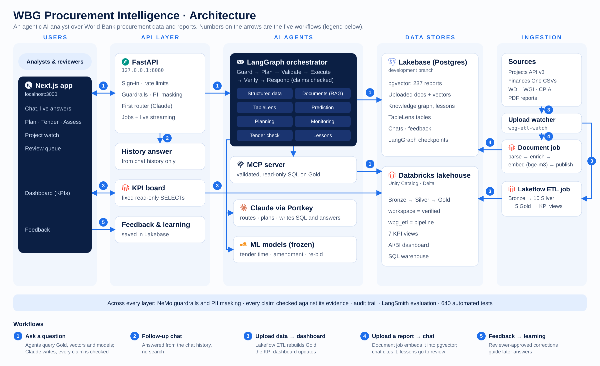

# WBG Procurement Intelligence

An agentic AI analyst for World Bank procurement. You ask a question in plain language. The assistant finds the
answer in the right places: the Gold data tables, the project reports and the prediction models. It returns one
answer, and every statement in it cites its source: a table row, a document page or a model.

| | |
| --- | --- |
| Status | Working proof of concept (demo-ready) |
| Scope | 2,000 World Bank projects (data); 35 projects in 5 countries (documents) |
| Start it | `uv run wbg-api` and `uv run wbg-web`, then open <http://localhost:3000> ([HOW_TO_RUN.md](HOW_TO_RUN.md)) |
| Plain-English guide | [docs/PROJECT_OVERVIEW.md](docs/PROJECT_OVERVIEW.md) |

---

## 1. The project

Procurement staff have to combine figures from many tables with what long project reports say. Finding a reliable
answer can take hours. General chatbots are fast, but they cannot show where an answer came from. This platform aims
to be fast **and** checkable. It answers only from World Bank data and documents. Claims without evidence are removed
before the answer is shown.

| Capability | What the user gets |
| --- | --- |
| Chat | Answers from the data, from the documents, or from both, with an evidence panel and live progress |
| TableLens | Exact figures read from the right table inside a PDF (10 pilot reports) |
| Package assessment | Predicted tender duration, amendment risk and re-bid risk, each with its drivers |
| Check tender | A tender draft compared with similar past packages, with the benchmark behind each flag |
| Project watch | Milestones, slippage and early warnings for a running project |
| Plan a new project | A cited planning brief built from similar past projects and approved lessons |
| Lesson cards | Lessons taken from completion reports and reviews; used only after a reviewer approves them |
| Dashboards | Headline KPIs from the Gold views; they update when new data is loaded |
| Feedback | Ratings and corrections. A correction is kept for its user, and shared only after review |
| Accounts | Sign-up, sign-in and recovery-code password reset. Each user sees only their own work |

Project watch, Check tender and lesson cards are rule-based. They work without Claude and give the same result every
time.

---

## 2. Architecture



The numbers on the arrows are the five flows in [Section 4](#4-flows). A PNG copy for slides is at
[docs/architecture/architecture.png](docs/architecture/architecture.png).

The system has six layers. Each layer talks only to the layer below it.

```text
 Browser          Next.js web app: chat, Project watch, Check tender, Dashboard, Review queue, sign-in
    │  HTTPS (JSON + server-sent events)
 API              FastAPI: sign-in and sessions, rate limits, request ids; one background job per message
    │
 Orchestration    conversation bridge (chat or investigation?) → LangGraph investigation engine
                  intake → supervise → plan → validate_plan → dispatch ⇄ execute → verify → respond → finalize
    │  controller: time limits, retries, circuit breakers, token/cost/time budgets
 Agents           structured data · documents (RAG, TableLens) · prediction · monitoring · tender · lessons · planning
    │
 Data             Databricks Gold tables and KPI views (read-only, through the MCP server)
                  Lakebase Postgres: document vectors, knowledge graph, lesson cards, feedback, accounts, checkpoints
    │
 Pipelines        Lakeflow jobs: Bronze → Silver → Gold → KPI views; document job: parse → embed → pgvector
                  laptop drop folders (ingestion_inbox/) → knowledge graph
```

### Design rules that hold throughout

- **Evidence first.** The `verify` step drops any claim that no task produced evidence for. If evidence is missing,
  the answer says so.
- **Read-only data.** Every SQL query is parsed and checked against an allow-list before it runs. Writes, deletes and
  unapproved tables are refused.
- **Failure is contained.** Each task runs under a deadline with retries. A source that keeps failing is paused by a
  circuit breaker, so one broken source never stops the whole answer.
- **Private by default.** The user's identity always comes from their server-side session. Another user's item looks
  as if it does not exist. Lakebase also enforces row-level security.
- **Cost is opt-in.** Claude is off unless the API is started with `--live`. Each session has a spending cap
  (US$ 5 by default).
- **Resumable.** Every investigation step is checkpointed in Lakebase, so a job can be reopened or continued after a
  restart.

---

## 3. Tools and technology

| Area | Tool | Role in the platform |
| --- | --- | --- |
| AI model | **Claude** (Anthropic), through the **Portkey** gateway | Routing, planning, question-to-SQL, answer writing |
| Orchestration | **LangGraph** + PostgreSQL checkpointer | The investigation graph, with saved and resumable state |
| Back end | **FastAPI** (Python 3.12) | HTTP API, sign-in, background jobs, live progress events |
| Front end | **Next.js 15** / React 19 | The web app |
| Data platform | **Databricks**: Unity Catalog, Delta, Lakeflow jobs, SQL warehouse, AI/BI dashboards | Bronze, Silver and Gold data; pipelines; dashboards |
| Data access | **MCP server** (FastMCP) + **sqlglot** | A separate read-only service for the Gold tools; SQL parsing and validation |
| App database | **Lakebase** (Postgres) with **pgvector** | Vectors (halfvec, HNSW), knowledge graph, lessons, feedback, accounts, checkpoints |
| Document search | **bge-m3** (sentence-transformers) + **BM25** | Hybrid search: by meaning and by keyword |
| Document parsing | **PyMuPDF**, **pdfplumber**, **python-docx**, **openpyxl**, **Tesseract OCR** (English, French) | Text, tables and scanned pages |
| Prediction | **scikit-learn** | Three frozen models: tender duration, amendment risk, re-bid risk |
| Safety | **NeMo Guardrails**, **Presidio** | Input screening; personal-data detection and masking |
| Observability | **Logfire** (OpenTelemetry), JSON log files, `wbg-logs` | Nested traces, per-session audit logs, security events |
| Evaluation | **LangSmith** end-to-end runs, golden no-LLM sets | Measured quality; results in [docs/evaluation/RESULTS.md](docs/evaluation/RESULTS.md) |
| Tooling | **uv**, **pytest**, Databricks Asset Bundles (`databricks.yml`) | One-command run and test; job deployment |

---

## 4. Flows

### 4.1 Ask a question (flow 1)

```text
 user ──► POST /conversations/{id}/messages ──► job started, job_id returned at once
            │
            ▼
 conversation bridge ── small talk / follow-up ──► answered from the chat history
            │ data or document question
            ▼
 intake      input guardrails: prompt injection, secrets, personal data, off-topic, length
 supervise   fixed one-step plan for a simple question, or hand over to the planner
 plan        Claude writes a multi-step plan (one task per agent)
 validate    plan checked: known agents and operations, permissions, task limits, no cycles; re-plan if invalid
 dispatch ⇄ execute   each task runs through the controller and its agent worker
 verify      every claim matched to evidence; unsupported claims removed (or re-plan)
 respond     the answer written from the verified evidence, with citations
 finalize    investigation saved; job marked done
            │
            ▼
 web app polls GET /jobs/{job_id} and streams GET /jobs/{job_id}/events, then shows the answer and its evidence
```

### 4.2 The other flows

| # | Flow | Path through the system |
| --- | --- | --- |
| 2 | Follow-up chat | "and for Kenya?" → the conversation bridge reads the chat history → answered from it, or a new investigation with the history as context |
| 3 | New data → dashboard | file uploaded to the ETL landing volume → `wbg-etl-watch` starts the Lakeflow job → Bronze, Silver and Gold are rebuilt, then the KPI views → the dashboard shows the new figures |
| 4 | New report → chat can cite it | file dropped in `ingestion_inbox/<type>/` → intake, classify, parse (OCR if scanned), mask, resolve, graph, embed → Lakebase → searchable in chat |
| 5 | Feedback → better answers | rating or correction → stored for that user → a reviewer approves it → used to guide later answers for everyone |

### 4.3 Follow one question through the code

1. [api.py](orchestrator/wbg_orchestrator/api.py) `POST /conversations/{id}/messages` starts a job and returns its
   `job_id`.
2. [app_service.py](orchestrator/wbg_orchestrator/app_service.py) `_guarded` runs the job in a worker thread. This is
   the root span `job.message`.
3. [conversation_bridge.py](orchestrator/wbg_orchestrator/conversation_bridge.py) `handle_message` routes it
   (`conversation.message`).
4. [graph.py](orchestrator/wbg_orchestrator/graph.py) runs the investigation steps. Each task goes through
   [controller.py](orchestrator/wbg_orchestrator/controller.py) to an agent in
   [workers/](orchestrator/wbg_orchestrator/workers/).
5. [verification.py](orchestrator/wbg_orchestrator/verification.py) and
   [response.py](orchestrator/wbg_orchestrator/response.py) check the claims and write the answer.

---

## 5. How the code is organised

Each top-level folder is one working component. Tests are kept apart in `tests/`.

```text
procurement-intelligence/
  orchestrator/wbg_orchestrator/   the app: API, accounts, jobs, LangGraph engine, agent workers, logging, commands
  frontend/            the Next.js web app
  conversation/        chat memory, intent routing, personal-data masking, feedback learning
  structured_agent/    data agent: question > SQL > validation > Databricks; guardrails; the MCP server
  rag/                 document agent: parsing, hybrid search, cited answers, TableLens, pgvector store
  ml/                  the three frozen prediction models and their serving code
  monitoring/          Project watch: milestones and early warnings
  tender/              Check tender: a draft checked against history
  lessons/             lesson cards from completion reports and reviews
  ingest/              drop-folder ingestion into the knowledge graph (ingestion_inbox/ holds the folders)
  etl/ silver/ gold/ resources/ databricks.yml   Databricks Lakeflow jobs: Bronze > Silver > Gold > KPIs
  wbdisc/              World Bank data helpers shared by the ETL and RAG
  app_config/          file locations (paths.py), dashboards, the settings check
  data/                input files: cohort, Bronze extracts and manifests, the RAG scope
  infrastructure/      Lakebase connection settings
  tests/               all tests, one folder per component; tests/live/ runs only with WBG_RUN_LIVE_TESTS=1
  docs/                architecture, decisions, reports, evaluation results
  demo/                demo questions with expected answers
```

---

## 6. Run, test and debug

```bash
uv sync                  # once
uv run wbg-api           # back end, Claude off (add --live to switch it on, --cap N to change the US$ 5 cap)
uv run wbg-web           # web app at http://localhost:3000
uv run wbg-test          # offline test suite (never calls a live system)
uv run wbg-logs          # latest job as a tree of steps; --failed, --session <id>, --sessions
```

Other commands: `wbg-user` (accounts), `wbg-ingest` (drop folders), `wbg-lessons`, `wbg-feedback`, `wbg-eval`,
`wbg-etl-watch` and `wbg-etl-seed`. See [HOW_TO_RUN.md](HOW_TO_RUN.md).

Each job writes JSON lines to `orchestrator/runs/logs/app.jsonl`. When Logfire export is on, it also sends one nested
trace to Logfire. Every line carries the session, job and step ids. Every graph step logs what it changed. A failure
is logged once, with its step, file and line.

---

## 7. Read next

| Document | What it covers |
| --- | --- |
| [docs/PROJECT_OVERVIEW.md](docs/PROJECT_OVERVIEW.md) | **Start here.** The plain-English guide to features, flow and file structure |
| [HOW_TO_RUN.md](HOW_TO_RUN.md) | Setup, start-up, every command, debugging |
| [docs/architecture/DATA_MODELING.md](docs/architecture/DATA_MODELING.md) | Bronze, Silver, Gold, documents and the graph |
| [docs/architecture/INGESTION_AND_KNOWLEDGE_GRAPH.md](docs/architecture/INGESTION_AND_KNOWLEDGE_GRAPH.md) | How dropped files become the knowledge graph |
| [etl/README.md](etl/README.md) | The Lakeflow pipelines and the live demo script |
| [docs/evaluation/RESULTS.md](docs/evaluation/RESULTS.md) | Evaluation results |
| [docs/decisions/](docs/decisions/) | Scope and data decisions (for example D-26 and D-32) |
| [demo/DEMO_QUESTIONS.pdf](demo/DEMO_QUESTIONS.pdf) | Demo questions with expected answers |
