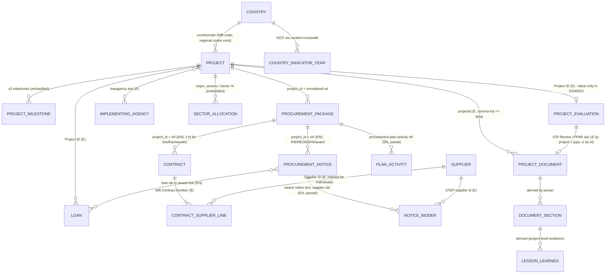

# Entity Resolution & Data-Modelling Feasibility

Run date 2026-10-20. Match rates come from
[`scripts/p02_join_analysis.py`](../scripts/p02_join_analysis.py) → [`profiling/join_analysis.json`](../profiling/join_analysis.json),
[`p05`](../scripts/p05_procurement_plan_tables.py) and [`p06`](../scripts/p06_ml_feasibility.py).

**Status:** this is a *candidate* model for review. It is **not** a production schema.

## Match-class vocabulary (used throughout)

| Class | Definition | Allowed use |
|---|---|---|
| **E – Exact** | Identical identifier in both sources | Hard join |
| **EN – Exact after deterministic normalisation** | Identical after a documented, reversible rule (case, separators, whitespace; loan prefix punctuation; curated code alias) | Hard join, with the rule versioned |
| **C – Deterministic composite** | Several fields must all agree (e.g. project + normalised reference + supplier ID) | Hard join when unique, otherwise candidate |
| **P – Probabilistic** | Text similarity / fuzzy scoring | **Candidate link only**: store score and method, never present as fact |
| **U – Unverified / not establishable** | No shared key, or the semantics don't support the link | Do not link |

---

## 1. Candidate entity relationship diagram

Notes on the diagram:
- **Procurement Package** is not published as an entity. It is *derived* as `(project_id, normalised borrower reference)`.
  It is the only key shared by notices, contracts and procurement-plan activities.
- **Contract** (`WB Contract Number`) and **Contract-Supplier line** (`WB Contract Number` × `Supplier ID`, unique in 100% of
  295,058 rows) are separate grains, because of JV splits.
- **Lesson Learned** and **Document Section** are platform-generated entities. They link to a project and a document, never directly to a contract (see §6).

---

## 2. Preliminary entity inventory

| Entity | Source(s) | Natural key | Key quality (measured) | Grain notes |
|---|---|---|---|---|
| Project | v3 projects; also in all sources | `Project ID` (`P\d{6}`) | 100% valid pattern in DS00005, DS00979, IEG; unique in v3 (28,193) | Additional financing gets its own P-number. The parent link (`parentprojid`) exists only in frozen v2 (9.7% populated). |
| Loan / Credit | DS00047, DS00001, DS00975/6, v3 `financers`/`loan_transactions`, award notice text | `Loan Number` / `Credit Number` (`IBRD87250`, `IDAD1010`) | 100% have `Project ID`; 1–10+ loans per project | Trust-fund grants (`TF-…`) are **not** in IBRD/IDA statements |
| Procurement Package (derived) | DS00005 reference, procnotices `bid_reference_no`, PP activity ref | (`project_id`, `normalize_ref(ref)`) | 241,935 keys for 282,890 contracts; 19.0% of contracts share a key | Free-text reference; 785 raw variants merged by normalisation |
| Procurement Notice | procnotices API | `id` (`OP\d{8}`) | Unique (30,977/30,977) | DS00979 uses the numeric form of the same ID |
| Contract | DS00005 | `WB Contract Number` | 282,890 distinct; consistent attributes across JV rows (0 conflicts) | FY2020+ only |
| Contract-Supplier line | DS00005 | (`WB Contract Number`, `Supplier ID`) | **Unique** (0 duplicates) | Amount = JV share |
| Supplier | DS00005, award notice text | `Supplier ID` (STEP) | 188,653 IDs; 22% of rows hashed (individuals); 580 IDs → multiple names; 9,567 name+country keys → multiple IDs | No public supplier master; no registration number |
| Implementing Agency | v3 `impagency`, notice `contact_organization`, PP header | **None** (free text) | `impagency` 29.8% populated; agreement with notice contact org ≥90 similarity in only 17.3% of pairs | Comma-joined multi-agency strings |
| Country | All | WB code (DS00005, projects) vs ISO2/ISO3 (Indicators) vs long names (IEG) | 135/146 borrower codes map 1:1; 12.4% of contract rows regional/unmappable | Curated alias table required |
| Sector | v3 `major_sectors` (code + %), DS00005 `Project Global Practice` | Sector code (`BBC`) / GP label | GP is project-level, multi-valued (48%), empty 10.3% | Sector ≠ Global Practice taxonomy |
| Project Document | WDS v3 | `id` (entity id); also `guid`, `repnb` | Unique per record; `projectid` multi-valued in 8.25% | Language versions and re-uploads create near-duplicates (1,783 in cluster) |
| Document Section | **Derived** (parser) | (doc id, section path, page span) | Not published | No PDF bookmarks in 22/22 sampled PDFs |
| Project Evaluation | DS00053; v3 `ieg_ratings`/`icr_ratings` | `Project ID` (+ evaluation type/FY) | One row per project (latest only); 1 duplicate (P122764) | Earlier evaluations not in DS00053; DS01695 (30,206 rows) may hold them (**unverified**) |
| Lesson Learned | **Derived** from ICR / ICRR / PPAR sections | (doc id, section, page) | Not published as data | Project-level, not contract-level |
| Project Milestone | v3 `milestones`; DS00047/1 dates; DS00975/6 history | (Project ID, milestone type) | Approval 97.7%; effectiveness 53%; ICR date 48.5% | Project-level only. **No contract-level milestones** exist in public data |

---

## 3. Join-key inventory

| Key | Appears in | Format differences | Normalisation | Class |
|---|---|---|---|---|
| Project ID | DS00005, DS01004, v2/v3 projects, procnotices, DS00979, WDS (`projectid`), DS00053, DS00047/1/975/976 | WDS may hold `P1,P2` lists | Uppercase; split comma lists | **E** |
| Contract number | DS00005 `WB Contract Number`, DS01004 `Contract Number` | Disjoint ranges (0 overlap) | — | E within dataset |
| Supplier ID | DS00005; award notice text `NAME (123456)` | Numeric vs 16-hex hash | Regex extraction from text | **E** (numeric IDs only) |
| Borrower reference ↔ `bid_reference_no` ↔ PP activity ref | DS00005, procnotices, PP PDFs | Case, spaces, `_`/`/`/`.`/en-dash separators; PP prefixes "ref / description" | `normalize_ref()` (tested) | **EN**, scoped by project |
| Loan number | Statements (`IDA70480`), notices (`IDA-70480`), v3 (`IDA-57620`), v2 `rel_loan_ids` | Hyphen | Remove separators | **EN** |
| Country | DS00005/projects WB codes; Indicators ISO2/ISO3; IEG names | `ZR`/`CD`, `GZ`/`PS`, `YF`/`RS`, `TP`/`TL`, `RY`/`YE`; regional codes | Curated alias table ([`countries.py`](../wbdisc/countries.py)) | **EN** (fuzzy rejected) |
| Notice ID | procnotices `OP00000014`; DS00979 `14` | Prefix + zero padding | `OP` + zfill(8) (100% verified via URL column) | **EN** |
| Document ↔ project | WDS `projectid` | Comma lists | Split | **E** |
| Evaluation ↔ evaluation document | DS00053 has no document ID | — | Project ID + doc type (ICRR/PPAR) + date proximity | **C/P**, unverified |

---

## 4. Join feasibility matrix (measured)

Denominators: DS00005 rows = 295,058; contracts = 282,890; projects in DS00005 = 3,155.
Notice joins use the **cluster**: all 30,977 notices and 22,402 contracts of 276 projects.

| # | Join | Key / method | Class | Match rate | Unmatched / ambiguity | Cardinality |
|---|---|---|---|---|---|---|
| J1 | Contract → Project (v3) | Project ID | E | **100%** of rows (3,155/3,155 projects) | 0 | N:1 |
| J1b | Contract → Project (v2, frozen) | Project ID | E | 99.81% (50 projects / 556 rows missing) | Staleness, not key quality | N:1 |
| J2 | Contract ↔ Project attribute consistency | — | — | Name 99.75%; region 100%; country code 95.28% | 4.7% country mismatch (regional vs national coding) | — |
| J3 | Contract → IBRD/IDA loans | Project ID | E | 91.56% rows (2,515/3,155 projects) | 640 projects: presumably TF/grant-only financing (**unverified**) | N:M (project has 1–10+ loans) |
| J4 | Contract → specific loan | — | U | Not available in DS00005 | Award notice lists loan IDs (98.7%) → **EN via notice** where J6 succeeds | — |
| J5 | Contract → IEG evaluation | Project ID | E | 36.14% rows; 37.65% of projects (1,188) | Most FY2020+ projects not yet evaluated | N:1 |
| J6 | Contract → Contract Award notice | project + normalised ref | EN | **70.23%** of contracts (raw exact: 69.95%) | 12,422 single; **3,310 multiple** candidates; 6,670 none | N:M |
| J6b | …confirmed by supplier ID | + awarded supplier ID ∈ notice | C | 10,067 of 11,740 matches with IDs agree (**85.7%**); **9,194 unique** composite matches | 1,673 disagree (re-awards, lots, JV members) | 1:1 when unique |
| J7 | Award notice (award date ≥ FY2020) → Contract | project + normalised ref | EN | 76.1% (15,408/20,246) | 24% of award notices have no DS00005 row | — |
| J8 | Contract → Tender notice (IFB/REOI/Prequal) | project + normalised ref | EN | **19.87%** overall | RFB 40.2%; QCBS 72.3%; CQS 41.2%; ICS 23.3%; RFQ 8.7%; Direct 0.02% (by design) | N:1 |
| J8b | …with valid tender start (see ML report) | + date validity rule | C | 3,782 contracts (16.9%) | 670 rejected as back-filled / zero-deadline | — |
| J9 | Unmatched contract → tender notice by description | rapidfuzz `token_set_ratio` | **P** | Of 1,500 unmatched: ≥90: 49; 80–89: 77; 60–79: 311; <60: 866; no notices: 197 | 26 ambiguous (top-2 within 5 pts) | Candidates only |
| J10 | Procurement-plan activity → Contract | project + normalised ref | EN | 33.3% of 1,137 activities; 30.1% of contracts found in the latest plan | Latest plan omits completed / older activities | N:M |
| J11 | Notice (DS00979) → Project (v3) | Project ID | E | 99.75% rows (5,863/6,175 projects) | 312 projects absent from v3 | N:1 |
| J12 | IEG → Project (v3) | Project ID | E | **100%** (12,628) | — | 1:1 |
| J13 | Contract country → WGI | WB code → crosswalk → ISO2 | EN | **100%** of mappable rows | **12.38%** of rows regional / empty code | N:1 by (country, year) |
| J14 | Contract country → CPIA | same | EN | 82.26% of mappable rows | CPIA covers IDA countries only | N:1 |
| J15 | IEG project → WGI at approval FY−1 | IEG → v3 countrycode → crosswalk | EN | 83.7% of FY1998+ projects; CPIA 58.6% of FY2006+ | Country-name join only 10.85% (rejected) | — |
| J16 | Project → Documents (v3, cluster) | projectid | E | ISR 98.9%; PP 100%; Project Paper 81.5%; PAD 78.3%; ICR 41.7%; ICRR 33.3%; PPAR 0% | 151 records carry a different/multi `projectid` | 1:N, M:N |
| J17 | Project impagency ↔ notice contact org | rapidfuzz | **P** | ≥90 similarity: 17.3%; <60: 63.3% (873 pairs) | Agencies don't resolve reliably | — |
| J18 | Award-notice loan IDs → statements | separator removal | EN | Format verified (`IDA-70480` ↔ `IDA70480`); match rate **not computed** | TF ids have no statement | — |

---

## 5. Relationship confidence classification

| Relationship | Confidence | Basis |
|---|---|---|
| Contract → Project, Notice → Project, IEG → Project, Loan → Project, Document → Project | **High (E)** | Shared, validated P-number; ≥99.75% match |
| Contract-Supplier line → Supplier (numeric IDs) | **High (E)**, entity quality **medium** | Same STEP ID, but 580 IDs carry multiple names |
| Supplier → real-world firm across IDs | **Low (P)** | 9,567 name-key collisions; no registration numbers |
| Contract → Award notice (unique composite with supplier ID) | **High (C)** for 9,194/22,402 (41%) | Project + ref + supplier ID all agree |
| Contract → Award notice (ref only) | **Medium (EN)** | 3,310 one-to-many cases |
| Contract → Tender notice | **Medium (EN)** where present; **coverage low** (≈20%) | Many methods are not advertised; references reused for lots |
| Contract → specific loan | **Medium (EN via notice)** | Only through a matched award notice |
| Contract → Procurement-plan activity | **Low–Medium (EN, partial coverage)** | PDF table parsing; 33% match |
| Country → indicators | **High (EN)** for national; **none** for regional | Curated alias table |
| Project → Implementing agency | **Low (text)** | 29.8% populated, free text, multi-valued |
| Project → Lesson / evaluation finding | **High (E)** at project level | Document belongs to the project |
| **Contract → Lesson / evaluation finding** | **Not establishable (U)** by default | See §6 |

---

## 6. Can a contract be linked to evaluation evidence?

The question was: can a contract-award row be linked to the project described in an ICR, and that contract to a specific
evaluation finding?

1. **Contract → project → ICR document:** yes. This is a **High (E)** project-level link: the contract's `Project ID`
   equals the ICR's `projectid`. In the cluster, 41.7% of projects have an ICR and 33.3% an ICR Review. Only 37.65% of
   DS00005 projects have any IEG rating, because most FY2020+ projects are still active.
2. **Contract → specific ICR finding:** **not establishable as a key-based link.**
   - ICRs, ICR Reviews and PPARs evaluate the **project**.
   - In the sampled ICRs, procurement appears as a sub-topic of "Fiduciary Compliance" and "Key Factors that Affected
     Implementation" (e.g. P122319 ICR pp. 29, 50; P145502 ICR pp. 20, 23, 25), without contract numbers.
   - Measured in [`profiling/contract_reference_in_documents.json`](../profiling/contract_reference_in_documents.json):
     ICR, ICR Review, ISR and PAD text of the 5 sampled projects that have DS00005 contracts (1–32 contracts each) contain
     **0** `WB Contract Number`s and **0** borrower references. Only one procurement plan contained 1 reference.
     The sample is small (5 projects), so this is indicative, not conclusive.
3. **Policy recommended for the platform:**
   - Evidence from ICR/ICRR/PPAR is labelled `scope = project` and linked to contracts only as **context**, i.e.
     "evidence about the project this contract belongs to".
   - A contract-scoped evidence link may be created only when the document text contains the contract's borrower reference
     or `WB Contract Number` (EN match inside the same project). It must then carry `link_method = reference_in_text` and
     the page/section citation.
   - Description-similarity links stay **P (candidate)** and are not shown as evidence.

---

## 7. Relationships needing normalisation vs probabilistic matching

| Needs deterministic normalisation (EN) | Needs probabilistic matching (P) | Not establishable (U) |
|---|---|---|
| Borrower reference ↔ notice ref ↔ PP activity ref | Supplier de-duplication across IDs / name variants | Contract → individual ICR finding (unless reference in text) |
| Loan number formats | Implementing agency entity | Contract → contract-level milestones (not published) |
| WB country codes → ISO | Contracts without reference match → notices by description | Contract → disbursements (loan-level only) |
| DS00979 numeric ID → `OP` ID | Evaluation record → specific ICRR/PPAR document (date proximity) | Individual consultant (hashed ID) across contracts |
| Comma-separated `projectid` | Lesson text ↔ procurement category/method | FY2017–FY2019 contracts (no data) |
| Label cleanup (whitespace, double spaces) | | DS01004 suppliers ↔ DS00005 suppliers (no ID in DS01004) |

---

## 8. Unresolved entity-resolution issues

1. **Supplier identity:** 580 STEP IDs map to multiple names, including clearly different firms (`818187`). 9,567
   normalised-name keys span multiple IDs. There is no public supplier master or registration number. *Decision needed:* trust
   the STEP ID as identity, or build a reviewed supplier-cluster layer.
2. **Package vs contract:** 19% of contracts share a (project, reference) key, up to 188 contracts per key. Award and
   tender notices attach to the **package**. Contract-level attribution needs the supplier-ID composite, which resolves 41%
   uniquely in the cluster.
3. **Award notices without contracts:** 24% of FY2020+ award notices have no DS00005 row (cause not established: reference
   drift, DS00005 filtering, or cancelled awards).
4. **Additional financing parents:** `parentprojid` exists only in frozen v2 (9.7%). v3 has no equivalent field. **Unresolved.**
5. **IPF filter:** v3 lacks `lendinginstr`. DS00053 has `Lending Instrument Type` for evaluated projects only.
6. **Regional projects:** 12.4% of contract rows have no single country. Governance features for multi-country operations need a policy (null, borrower-level, or weighted).
7. **Implementing agency:** 70% of projects have no `impagency`. Notices name different organisations (PIUs, ministries, consultants).
8. **Evaluation history:** DS00053 keeps only the latest evaluation. Whether DS01695 (30,206 rows) holds full history is unverified.
9. **Document near-duplicates:** 1,783 records in the cluster share project/type/date/title. Version vs language vs re-upload is not distinguishable from metadata alone.
10. **Award-notice loan IDs → statements:** the format was verified but the match rate was not computed in Phase 1.

---

## Alignment update (2026-10-21)

Assessment Module 1 asks for an ER schema or **Knowledge Graph** that reconciles disjoint keys. Its example links "a supplier
contract row to a specific section of an ICR lesson learned via Project ID, sector codes, and temporal proximity". Measured
evidence ([`profiling/assessment_gap_probes.json`](../profiling/assessment_gap_probes.json) G2, G5):

1. **Project ID:** exact (J1, J16). This part of the example is a High-confidence link.
2. **Sector codes:**
   - There is **no shared code** between the Global Practice taxonomy (DS00005: 16 labels; IEG: 18; exact overlap 1,
     "Education") and the sector taxonomy (v3 `major_sectors`: 35 codes, 82.9% populated; WDS sector objects: 25 labels,
     all matching v3).
   - Sector-based linking needs a curated GP ↔ sector crosswalk (D-21), and is valid only at project level (GP in DS00005
     is a project attribute).
3. **Temporal proximity:** contracts are signed inside their project's implementation period by construction, so temporal
   proximity adds ranking signal (e.g. lessons from documents disclosed before the contract date), not identity.
4. **Conclusion:**
   - The assessment's example is a **contextual-relevance link (class P)**: scored, with `evidence_scope = project` (or
     `sector` / `country` for CPF / SCD / thematic evaluations) and the scoring features stored.
   - It must never be presented as contract-specific evidence (§6 policy unchanged).
   - KG vs relational representation is decision D-19.

**New relationships:**

| Relationship | Key | Class | Measured |
|---|---|---|---|
| Project → ISR (series) | `projectid` + ISR `Seq No` | E (after de-duplication) | Seq repeated up to 8× (re-uploads) |
| Evaluation supersession (ICRR / PCR → PPAR) | Project ID + evaluation type + date | E | 782 projects where DS00053 (latest) ≠ v3 `ieg_ratings` (earlier) |
| Procurement-plan activity → successor activity after cancellation | Same plan; normalised ref (EN) or description similarity (P) | EN: 3; P: 41 of 350 cancelled | `profiling/procurement_plan_reprocurement_candidates.json` |
| OKR item → WDS document | `okr.guid` = WDS `guid` | E | 5 / 5 sampled |
| CPF / SCD / IEG thematic → country / sector | Country / sector labels | EN (country crosswalk) | 0% project-linked |
