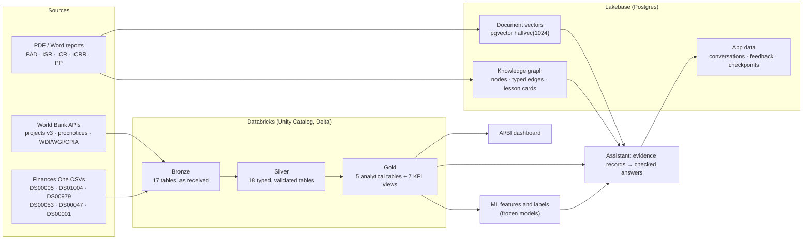

# How we modelled the data

This is the story of how data moves through the WBG Procurement Intelligence platform: from World Bank downloads and
PDF reports to the tables, the knowledge graph and the evidence that the assistant cites in its answers. It explains
what we built, and why we built it that way.

## The short version

We use three kinds of data, and we modelled each one where it fits best:

1. **Structured procurement data** (projects, contracts, notices, loans, ratings, country indicators). This goes through
   a **medallion architecture** in Databricks:
   - **Bronze** keeps the data exactly as it arrived;
   - **Silver** makes it typed and trustworthy;
   - **Gold** shapes it for the questions people actually ask.
2. **Documents** (appraisal documents, completion reports, implementation reports, procurement plans). These are broken
   into **sections, paragraphs, chunks and tables**. They're embedded as vectors in **Lakebase (Postgres + pgvector)**
   and linked into a **knowledge graph**.
3. **The application's own data** (conversations, feedback, lesson cards, investigation checkpoints). This lives in
   **Postgres on Lakebase**, scoped to each user.

One rule runs through all of it: **every number the assistant states can be traced back to a row, a page or a model,
and every transformation can be re-checked independently.**

---

## 1. Deciding what to model

Before modelling anything we decided **what is in scope**. That kept the model small enough to verify completely.

- **The 2,000-project cohort (decision D-26).** The World Bank has about 28,000 projects in the v3 API. We started from
  the 3,120 projects that are Active or Closed, have at least one DS00005 contract (FY2020 onward) and at least one
  DS00979 notice. From those we drew **2,000 projects with a stratified sample**:
  - strata by region × status × approval-year band × contract-volume quartile;
  - proportional allocation;
  - systematic sampling inside each stratum;
  - swaps so that every country with two or more eligible projects is represented.

  The cohort is a CSV file with a recorded SHA-256 fingerprint. Every later step checks that the file hasn't changed.
- **Reference data isn't cut to the cohort (D-28).** Country indicators (WDI, WGI governance scores, CPIA ratings,
  income groups) are kept for every country and year. Joins to projects happen later, in Silver and Gold.
- **Documents: 35 projects in 5 countries (D-32).** Reading PDFs well is expensive, so the document side uses a fixed
  set of 35 projects. A test enforces that scope.

## 2. Bronze: keep it exactly as it came

**Bronze is our "receipt" layer.** It has 17 Delta tables in two schemas:
- `wbg_bronze`: the 9 procurement sources, cut to the cohort;
- `wbg_ref_bronze`: the 8 reference sources, not cut.

How we modelled it:
- **Nothing is interpreted.**
  - CSV sources keep every published column, with its original name, as `STRING`.
  - API sources keep each record as a raw JSON line in `raw_record`.
  - The income-classification workbook is stored as its exact bytes (`raw_file BINARY`).
- **Selection never changes bytes.** The cohort cut is pure row selection: a record is kept when its project ID equals
  a cohort ID exactly, with no trimming and no case-folding. The selected lines are copied byte for byte. So the
  extract has a stable SHA-256, and Silver can re-read the source file and prove that Bronze equals it, line for line.
- **Lineage columns on every row:** `source_file`, `cohort_id` (`wbg_poc_2000`) and `ingested_at`.
- **A manifest for every file:** source URL, retrieval time, source vintage (for example WDI "last updated
  2026-10-08"), record counts and SHA-256 fingerprints.

Why bother? When a Gold number looks odd, we can walk it back to the exact line of the exact file we downloaded.

## 3. Silver: make it trustworthy

**Silver is where data becomes typed, keyed and checked.** There are 18 tables in `workspace.wbg_silver`. Each one has a
clear **grain**: one sentence saying what a single row means.

| Table | One row is… | Rows |
| --- | --- | --- |
| `projects` | a cohort project | 2,000 |
| `contract_award_lines` | a contract × supplier line (DS00005) | 186,907 |
| `contract_awards` | a contract | 178,921 |
| `contract_awards_legacy` | a prior-review contract, FY2001–2016 (DS01004, frozen) | 6,448 |
| `procurement_notices` | a published notice (DS00979, metadata only) | 243,533 |
| `procurement_notice_details` | a notice with its text and bid reference (API; text masked) | about 20,000 |
| `notice_contract_link_candidates` / `notice_contract_links` | a possible / an evidence-supported notice ↔ contract link | — |
| `ieg_project_ratings` | an IEG evaluation (latest per project) | 750 |
| `ibrd_loans` / `ida_credits` | a loan / a credit instrument | 612 / 2,073 |
| `project_details_v3` / `project_loan_transactions` | a project's full v3 record / a loan transaction | 184 / 16,643 |
| `wdi_indicator_observations` / `wdi_country` | country × year × indicator / a country or aggregate | 20,748 / 296 |
| `income_classification_history` | country × fiscal year income group | — |
| `wgi_estimates` / `cpia_ratings` | country × year × governance dimension / CPIA series | — |

The modelling decisions that matter most:
- **Missing is not zero.** An absent amount is `NULL`; a published `0` stays `0`. We never impute.
- **Regional projects stay regional (D-29).** Multi-country projects (codes like `3W`) are kept, flagged
  `regional_multicountry`, and **never** matched to a country. Some regional codes collide with WDI aggregate codes that
  mean something else.
- **Country matching is explicit (D-07, D-31).** A project joins to WDI only on an exact code, or through a small,
  approved alias table (for example `ZR → CD`). Anything else stays unmatched and is reported.
- **Snapshots are labelled (D-20).** Values that are only "as of extraction" (ISR ratings, current status) are kept as
  typed snapshots, named `*_snapshot` in Gold. They are never treated as history.
- **Links are graded, not guessed.** A notice is linked to a contract only when the evidence supports it: same project,
  the same normalised reference and, for award notices, a matching supplier ID. Ambiguous pairs are kept as candidates,
  with their cardinality (`one_to_one`, `many_to_many`, …), and are never presented as unique links.
- **Sensitive text is protected in the table itself (D-14).** `notice_text` has a Unity Catalog **column mask**,
  declared in `CREATE TABLE` and confirmed in `information_schema` before any row is written. Only members of a
  restricted group see the text; everyone else sees a placeholder.

How Silver is kept honest:
- **Delta constraints:** `NOT NULL` on keys and lineage columns, and `CHECK` constraints (for example
  `project_id RLIKE '^P[0-9]{6}$'`), plus a comment on every column.
- **Data-quality reports:** every run produces a DQ report. "Error" checks (unique keys, no parse failures, Bronze
  equals the source file, no element lost when nested arrays are flattened) block the write. "Warn" checks are reported.
- **Independent verification:** after each write, a separate script recomputes the table in plain Python and compares
  every value.
- **Create-only:** a Silver job never overwrites a table; a change means a new, reviewed build. An audit job checks all
  18 tables together (relationships, reference joins, privacy, Gold readiness).

## 4. Gold: shape it for the questions

**Gold is our analytical model.** There are 5 tables and 7 views in `workspace.wbg_gold`, built only from Silver. We used
**dimensional-modelling** thinking: each table is a fact or snapshot at one clear grain, and **the project is the shared
(conformed) key** across them.

### Finding the common link

**`project_id` is the link everything hangs on.** Every World Bank source carries it: contracts, notices, loans,
ratings and documents. It always has the same form (`P` + 6 digits, enforced by a Silver `CHECK` constraint), so it
became the conformed key of every Gold table.

The other links were harder, and each one got its own rule:

| Link | How it's made | The catch |
| --- | --- | --- |
| Contract → project | `project_id` on DS00005 | None. This is the backbone. |
| Notice → contract | Same project **and** the same normalised procurement reference (plus the supplier ID for award notices) | DS00979 notices have **no reference number**. Only the procnotices API does, so only **184 of the 2,000 projects** can be linked. Description similarity was not accepted as evidence of identity. |
| Project → country | The exact `wdi_country_code`, or the approved alias table (`ZR → CD`) | Regional projects (`3W`…) are never matched to a country, because some regional codes collide with WDI aggregate codes. |
| Contract → procurement-plan row | The STEP activity reference in the plan | This needed older plan versions as well (see section 7). It is a graph edge, not a Gold join. |

### How the Gold tables were built

1. **Pick the grain first.** Each table must answer "what is one row?" before any column is added.
2. **Aggregate before joining.** There are about 1.27 supplier lines per contract, so lines are summed to the contract
   first and only then rolled up to the project. The total contract value reconciles exactly across the contract
   fact, the portfolio and the supplier lines.
3. **Build the hub last.** `gold_project_portfolio` collects the per-project counts, totals, flags, ratings and country
   context (at the approval year) from the other tables, which have already been aggregated.
4. **Put the semantic layer on top.** The KPI views read one fact table each (see below).

| Gold table | Grain | Rows × columns |
| --- | --- | --- |
| `gold_project_portfolio` | one row per cohort project: a **current-state accumulating snapshot** (counts, totals, flags, ratings, country context at approval) | 2,000 × 61 |
| `gold_contract_analytics` | one row per contract (the **contract fact**) | 178,921 × 54 |
| `gold_procurement_notices` | one row per notice (the **notice fact**) | 243,533 × 52 |
| `gold_financing_analytics` | one row per IBRD loan / IDA credit | 2,685 × 65 |
| `gold_country_context` | one row per economy × year, 2000–2025 | 5,642 × 41 |

The six Gold rules (they prevent the classic mistakes):
1. **Aggregate to the target grain before joining.** Contract amounts are never summed over supplier lines or notice
   links, so there's no double counting. The total contract value, US$85,248,987,799.45, reconciles exactly between
   the contract fact, the portfolio and the supplier lines.
2. **Money stays in its own lane.** Contract values, IBRD/IDA financing, project commitments and loan transactions sit in
   separate, labelled columns. No ratios, no currency conversion, no reconciliation by guesswork.
3. **0 versus NULL is meaningful.** `0` is only used for counts from complete sources. Partial or unavailable data is
   `NULL` plus a `has_*` flag.
4. **Countries come only from the validated `wdi_country_code`.** Regional projects get no country context.
5. **No personal or free-text fields in Gold:** no supplier names or IDs, descriptions, notice text, team leaders or raw
   records.
6. **Snapshots are named `*_snapshot`,** with the source's as-of date, and they're not used as historical ML features.

**The semantic layer: KPI views (D-23).** On top of the five tables there are seven `vw_kpi_*` views:
- overview;
- contract awards;
- contract-value distribution;
- notice activity;
- response windows;
- country comparison;
- financing instruments.

Each view aggregates **one** fact table, exposes numerator and denominator, and carries the source as-of dates and Gold
run IDs. Two views return **subtotals at several levels** in one result, marked by a `grouping_level` column (built
with `GROUPING SETS`). The rule is to filter to exactly one level and never sum across levels. The AI/BI dashboard
("WBG procurement KPIs", `gold/dashboards/kpi_dashboard.py`) reads only these views.

## 5. Data for the ML models

The three models (tender time, amendment risk, re-bid risk) read Silver and Gold **read-only** and write nothing back.

### How the features were chosen

1. **The prediction moment came first.** For tender time it is **tender publication**:
   - at the planning stage, the data needed isn't in Silver;
   - at signing, the answer is already known.

   That one choice decides what is allowed: a feature counts only if it is known on that day.
2. **EDA on the 2,114 real labels** (`ml/reports/ML_EDA_REPORT.md`):
   - **Kruskal–Wallis tests by group:** method and review type dominate. QCBS has a median of 375 days against 72 for
     RFQ, and prior review 324 days against 123 for post review.
   - **Spearman correlations:** the published bid window is the strongest numeric signal (ρ 0.31).
   - **Governance and macro indicators:** weak (|ρ| ≤ 0.19), current-vintage, and collinear (WGI VIF up to 5.1), so
     they belong in a sensitivity run, not the main model.
3. **Leakage removed** (see `ML_FEATURE_INVENTORY.csv`):
   - contract amount, because DS00005 values can include later revisions;
   - supplier data;
   - ISR and IEG ratings;
   - `*_snapshot` fields;
   - current-vintage WDI, WGI and CPIA values.

### Feature engineering

- **Target:** ln(days). The skew drops from 2.11 to −0.62.
- **Log transforms:** `log1p` on the bid window and on the count of prior notices.
- **As-of features:** a feature may only use what was known at the moment of prediction, for example:
  - the project's age at tender;
  - the number of tenders published *before* the tender date.

  Leakage tests check this.
- **Point-in-time context:** the income group at the tender's fiscal year (OGHIST), as an ordinal (L = 1 … H = 4).
- **Rare categories:** grouped rather than dropped:
  - countries with fewer than 20 training rows are grouped;
  - regional projects get their own `REGIONAL` level;
  - rare methods go into "Other";
  - unseen values are mapped to "infrequent".
- **Cleaning:** sector names lose their "FY17 -" taxonomy prefixes.
- **Missing values:** flagged, never filled with zero. CPIA, for example, is missing for 75% of upper-middle-income
  countries.
- **Folds grouped by package,** because lots of one package share a start date.
- **A simple benchmark ships with the model.** The method × category median is nearly as accurate on MAE (74.3 vs
  76.7 days). Ridge earns its place on long-tender risk (PR-AUC 0.54 vs 0.37).

### Labels, splits and outputs

- **Labels come from the data, with honest gaps.** The tender-time labels (2,114 cohort tenders) come from notices
  matched to contracts. There aren't enough real amendment and re-bid labels, so those two models were trained on
  **synthetic** labels from a frozen generator, and every answer says so.
- **Chronological splits, scored once.** Training and validation come before a cutoff date and the test set after it.
  The test set was scored exactly once, and the models are frozen and hash-verified at load time.
- Packages are grouped by a SHA-256 prefix of (project, normalised reference), so no contract references appear in the
  ML outputs.

## 6. Documents: from PDFs to retrievable units

Each report is turned into **one document model**, so retrieval and the graph agree on what a "piece" of a document is:

**document → sections (a tree) → paragraphs → chunks**, plus **tables → rows** and, for procurement plans,
**plan activities**.

- **Sections keep the hierarchy** (for example `3 > 3.2 Procurement arrangements`) and a topic tag (lessons, risks,
  procurement, results…). Chunks never cross a section boundary.
- **Chunks** are about 500 tokens. Table rows are kept whole, with the header repeated when a table is split.
- **Personal data is masked** before anything is stored.
- **Vectors:** every retrieval unit is embedded with **bge-m3** (1024 dimensions) and stored in Lakebase as
  **`halfvec(1024)`** with an **HNSW** cosine index. Half precision halves the storage, which kept us inside the 512 MB
  Free Edition cap.
- **Releases are immutable.** A corpus build is loaded as one `release` with fingerprints of its text and vectors.
  The retriever checks the release against its local corpus and model before searching, so a mismatch fails instead of
  quietly returning wrong neighbours.
- **TableLens:** 78 PDF tables were loaded as real SQL tables, so table questions can be answered with SQL instead of
  text similarity. Their values are still marked as *not approved figures*.

### How the chunking was chosen

We compared three strategies on 10 pilot PDFs (`rag/corpus_v3/processed/pilot_v2/CHUNKING_COMPARISON_REPORT.md`):
- **A:** whole sentences in one section, about 500 tokens;
- **B:** page-aware recursive, 300–500 tokens;
- **C:** parent + child, with children of about 250–400 tokens for matching and parents of about 800–1,500 for context.

**First, integrity.**
- Does a chunk ever cut a sentence? B cut 70 at page breaks; A and C cut none.
- Does it cross a section boundary?
- Does every citation point back to the exact page text? All three passed: 100% of spans re-verified.

**Then, retrieval** (27 hand-checked questions, `rag/retrieval/RAG_RETRIEVAL_MVP_REPORT.md`):
- **C, with hybrid search and the guard layer, did best:** recall@5 0.89 vs 0.81 for A. C's parents also give the
  answer writer section context.
- **The largest single gain came from the guard layer, not the chunking.** Exact lookup of references such as
  `SN-PDEC-237672-CW-RFQ` lifted recall@5 from 0.70 to 0.81. Procurement identifiers are lexical, which is also why
  dense search alone was weakest.

**What we kept:**
- strategy C for narrative text;
- tables and plan rows as whole, separate units;
- no chunk crossing a section;
- a short header on every unit (document type, project, section).

## 7. Which documents mattered, and for what

The corpus is 237 PDFs from the 35 projects. Each document type answers a different kind of question:

| Document | Count | Most important for |
| --- | --- | --- |
| **Procurement plans (PP)** | 85 | **The link between documents and contracts:** activity rows, methods, estimated amounts and planned dates. No other source has plan data. |
| **Implementation status reports (ISR)** | 70 | **The current state:** PDO and implementation ratings, risk, disbursed and cancelled amounts, revised closing dates |
| **Project appraisal documents (PAD)** | 35 | **The starting point:** objectives, procurement arrangements, risks, original financing |
| **Implementation completion reports (ICR)** | 25 | **Outcomes and lessons:** the main source of lesson cards |
| **IEG ICR reviews (ICRR)** | 22 | **The independent verdict.** It often differs from the ICR's self-rating, so both must be shown. |

**Procurement plans mattered most, and the choice of plan versions mattered too.**
- With only the 35 latest plans, 64% of contracts that carry a STEP reference had a matching plan row.
- Adding 50 carefully chosen older versions raised that to **83%**, within 1.2 points of using all 2,111 available
  versions (`rag/module1_discovery/rag_scope_v3_35_projects/RAG_SCOPE_v3_35_PROJECTS_REPORT.md`).

**Language.** Every narrative report is in English. French appears only in about 7 Senegal procurement plans (plus a
few bilingual ones), even though the catalogue metadata lists all 237 as English.

## 8. What the data told us

| Data | Insight |
| --- | --- |
| DS00005 contracts | Contract values are extremely skewed (median US$29,923, skew 64), so we report medians and ranges, not averages. |
| procnotices + DS00005 | Tender to signing takes a **median of 144 days**. QCBS and prior review are the slowest; LAC is the slowest region (235 days). Durations are **shortening** over time, which is a drift risk for Model 1. |
| The linking funnel | Only 1.2% of cohort contracts can be labelled, and about 39% of packages never link. This is the biggest data gap, and the strongest argument for STEP access. |
| DS00979 notices | The median published bid window is 18 days; 18.3% of notices have no positive window. |
| WGI / CPIA | These barely explain tender duration. CPIA is missing not at random (75% missing for upper-middle-income countries). |
| PAD → ISR | Financing changes over a project's life. For example, Ethiopia's IDA-56250 went from US$370m at appraisal to US$264m, with US$97m cancelled. |
| ICR vs ICRR | Self-ratings and IEG ratings disagree, so the assistant shows both sources. |
| Amendment / re-bid search | Public data has no verified amendment or re-bid labels, which is why Models 2 and 3 are clearly labelled demonstrations. |

## 9. The knowledge graph (`wbg_kg` on Lakebase)

The graph connects documents, structured records and lessons, so the assistant can answer questions like "what did we
learn from contracts like this one?".

- **Nodes** have a typed ID prefix: `project:`, `document:`, `section:`, `chunk:`, `table:`, `activity:`, `contract:`,
  `notice:`, `country:`, `sector:`, `lesson:`, `stage:`…
- **Edges** come from a fixed **edge catalog**. Each edge type says which node types it may connect, so the graph can't
  drift into nonsense. The `edge` table is **list-partitioned by edge type** into:
  - hierarchy (`HAS_SECTION`, `HAS_CHUNK`, `NEXT`, `HAS_LESSON`…);
  - semantic (`ABOUT_TOPIC`, `MENTIONS`, `LESSON_FOR`, `FOR_STAGE`);
  - procurement (`PLANNED_AS`, `AWARDED_UNDER`, `NOTICE_FOR`…);
  - context (`IN_COUNTRY`, `TEMPORALLY_NEAR`).
- **Every link has a match class and a confidence:**
  - `E`: exact key;
  - `EN`: exact after normalisation;
  - `P`: probabilistic (for example a fuzzy match within the same project, or closeness in time).

  The evidence for the link is stored with it. A probabilistic link is never presented as certain.
- **Lesson cards** are paragraphs from the lessons sections of ICRs, IEG reviews and PADs. Each has a stable ID,
  topics, lifecycle stages and a review status:
  - `proposed`: the default;
  - `approved` or `rejected`: set by a reviewer.

  Only approved cards are used in answers. Re-ingesting a document keeps the reviewer's decision.

## 10. The application's own data

The assistant's working data is modelled in Postgres on the Lakebase **development branch**. Production is refused in
code.

| Store | Tables | What it holds |
| --- | --- | --- |
| Conversations | `threads`, `turns`, `decisions`, `summaries`, `folders`, `thread_folders`, `bookmarks` | Each turn with its route, status and the evidence it cited. User decisions are recorded explicitly, never inferred. |
| Feedback and learning | `feedback`, `preferences`, `learned_items`, `learning_uses`, `reviews` | Thumbs up/down, corrections, reviewer-approved learning, and where each learned item was used |
| Lesson cards | `lesson_card` | Proposed, approved and rejected lessons |
| Investigations | LangGraph `PostgresSaver` checkpoints | Each investigation's state after every step, so a run cut off by a restart can be recovered |

Everything is **owner-scoped**. Every read checks the tenant and the user, and the feedback and learning tables also
enforce **row-level security** in Postgres. Users appear in logs only as a pseudonymous hash.

## 11. How data becomes an answer: the evidence model

Agents never pass raw rows to the language model. They pass **evidence records**, a small typed contract.

Each record carries:
- its **source** (Gold objects, document and pages, model);
- a **citation**;
- **provenance** (validation ID, SQL fingerprint, page check);
- bounded **facts** and a short **summary**.

Each record also has a `numeric_use` label, which tells the answer writer what it may do with the numbers:
- `approved`: validated dataset values; quotable as facts;
- `document_statement`: a figure stated in a report; quotable with its citation;
- `not_approved`: for example PDF table values; never stated as figures;
- `model_estimate`: output of a frozen model; stated only as an estimate.

After Claude writes the answer, **every claim is checked against the evidence.** A claim is removed if:
- it cites evidence that doesn't exist;
- it states a number or date not in its evidence;
- it uses a number from a source not approved for figures.

The answer says how many statements were removed, and it opens with "No evidence found…" for any part of the question
that found nothing.

## 12. Principles that run through everything

- **One clear grain per table.** If we can't say what one row is, the table isn't ready.
- **Keep the original, derive the rest.** Bronze keeps the bytes; Silver and Gold are always rebuildable from it.
- **Missing ≠ zero, snapshot ≠ history, candidate ≠ link.** These distinctions are in the columns, not in people's
  heads.
- **Every number is traceable** through lineage columns, manifests, run IDs and evidence records.
- **Checks block, people decide.** Automated checks stop bad writes; scope and modelling decisions are recorded as
  numbered decisions (D-07, D-14, D-20, D-23, D-26, D-28, D-29, D-31, D-32).
- **Privacy by design.** No personal or free-text fields in Gold; notice text is masked at the column level; personal
  data is masked in documents and messages.
- **Read-only where it counts.** The assistant reads Gold through a validator and a read-only identity. It writes only
  its own operational data.

## 13. Running it again

The Silver and Gold jobs were built to produce one verified snapshot. A Lakeflow ETL job, prepared in the
`databricks-deploy` worktree and **not yet deployed**, re-runs the same jobs when new files are uploaded:
- it writes into a separate catalog;
- the real data rules still block a bad run;
- the checks that only pin the October 2026 snapshot (exact row counts, totals) become warnings.

## Glossary

| Term | Meaning here |
| --- | --- |
| **Medallion architecture** | Bronze (raw) → Silver (clean) → Gold (analytical) layers |
| **Grain** | What one row of a table represents |
| **Fact table** | Rows are events or things being measured (a contract, a notice) |
| **Accumulating snapshot** | One row per entity, updated with its latest state (the project portfolio) |
| **Conformed key** | A key shared by many tables, so they join consistently (`project_id`) |
| **Delta table** | Databricks' table format with transactions, history (time travel) and constraints |
| **Column mask** | A Unity Catalog rule that hides a column's values from users outside a group |
| **pgvector / HNSW** | The Postgres vector extension, and its fast approximate nearest-neighbour index |
| **halfvec** | A 16-bit vector type: half the storage of standard vectors |
| **Match class** | How sure a link is: exact (`E`), exact after normalisation (`EN`), probabilistic (`P`) |
| **Evidence record** | The typed package of facts and citation an agent hands to the answer writer |
| **As-of feature** | A model input that uses only what was known at prediction time |
