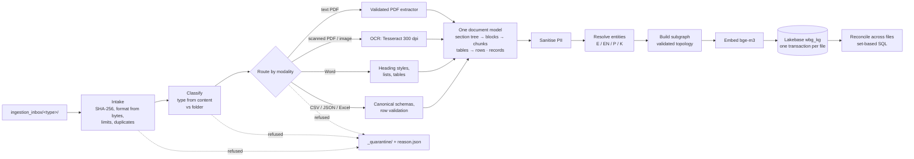
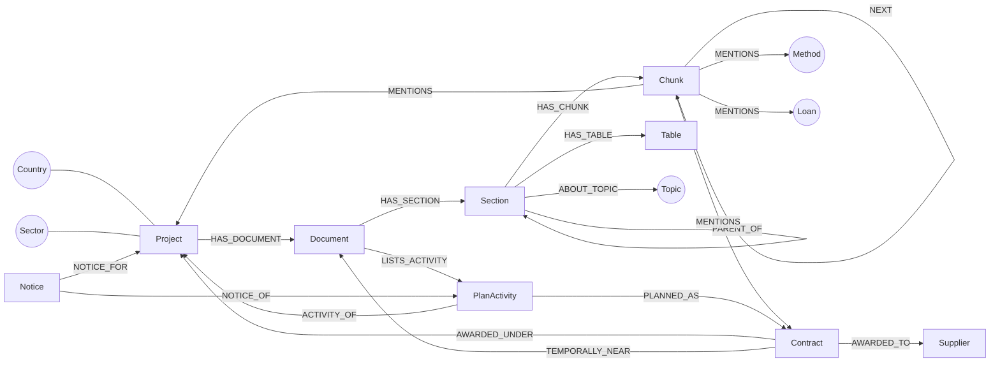

# Automated multimodal ingestion and the procurement Knowledge Graph

Module 1 of the assessment: an ETL and entity-resolution pipeline for tabular feeds and unstructured documents,
a Knowledge Graph and relational schema that reconcile records across disjointed keys, and the parsing, hierarchy
and chunking of long multilateral reports.

**Code:**
- `ingest/` (pipeline);
- `ingest/sql/kg_schema.sql` (schema);
- `ingestion_inbox/` (drop folders);
- `tests/ingest/` (38 tests).

**Store:** Lakebase (PostgreSQL 18 with pgvector), schema `wbg_kg` on the development branch.

## 1. How it runs

**Commands** (from `orchestrator/`):
- `python -m ingest run` processes everything new, once;
- `python -m ingest watch` ingests files as they land, waiting until a file has stopped growing;
- `python -m ingest status | lessons <contract> | neighbours <node>` query the graph.

**Folders:**

| Folder | Accepts | Becomes |
| --- | --- | --- |
| `pad/` | PDF, Word, scans | Document (PAD) |
| `isr/` | PDF, Word, scans | Document (ISR) |
| `icr/` | PDF, Word, scans | Document (ICR or ICRR, detected) |
| `procurement_plans/` | PDF, Word, Excel, CSV, JSON | Document (PP) with typed plan activities |
| `contracts/` | CSV, JSON, Excel | Contract records |
| `notices/` | CSV, JSON, Excel | Notice records |
| `other/` | any of the above | type detected from the content |

## 2. Robustness of multimodal ingestion

**Every failure is explicit.** A file is either fully in the graph or quarantined with a reason and an instruction;
there is no partial state.

| Situation | What happens |
| --- | --- |
| Wrong or misleading extension | Format read from the bytes (`%PDF`, ZIP contents, image magic, JSON/CSV sniffing) |
| Legacy `.doc` / `.xls`, encrypted PDF, corrupt file, empty or over 200 MB, over 2,000 pages | Quarantined with the fix ("save it as .docx…", "remove the password…") |
| File in the wrong folder | The cover is classified (PAD/ISR/ICR/ICRR/PP); a contradiction is quarantined (`type_mismatch`). An ICR Review in `icr/` is accepted as ICRR |
| Scanned PDF or image | Pages without a text layer are detected. Fully scanned files go to OCR (English and French), and low-confidence pages are reported. Without Tesseract: quarantined `needs_ocr` |
| Partly scanned PDF | Processed, with `pages_without_text_layer` reported |
| Feed columns named differently | Aliases after normalisation ("WB Contract No." = `wb_contract_no`); unknown columns are kept in `extra` |
| Messy values | Amounts ("US$ 1,234.5", "1.2m"), dates (ISO, d/m/Y, "14-May-2019", Excel dates); ambiguous day/month is read day-first and reported |
| Bad rows | Rejected with reasons per row. A missing required column, or more than 50% bad rows, quarantines the file |
| Personal data | Text sanitised by the corpus rules; an individual consultant becomes `[INDIVIDUAL]`; raw text never enters the graph |
| Same file dropped twice | No-op (`duplicate`). Files done by an older pipeline version are redone |
| Corrected file, same name | Replaces its document's subgraph in one transaction; no stale sections or chunks |
| Unexpected crash in any stage | Quarantined `pipeline_error` with the error class; the graph is untouched (observed live) |
| Large file still copying | Watch mode waits until the inbox is quiet and no pending file is growing |

**Lineage.** Every file is recorded in `source_file` with its hash, format, modality, status, reason, warnings,
rejected rows and pipeline version. Each run is recorded in `ingest_run` and in `_ledger/`.

## 3. Unstructured text and document hierarchy

**The model is the same for every modality:**
- Document → Section tree (level, parent, path such as "IV. BANK PERFORMANCE > B. ENVIRONMENTAL…", page range,
  kind, topic) → Blocks (paragraph, list item, heading, table text) → Chunks;
- Tables → rows.

**Text PDFs** reuse the validated corpus extractor (`rag.ingestion`, profile 3.0.0). It provides:
- heading detection with levels and printed page labels;
- paragraphs with source spans;
- table repair (glued and stacked cells);
- parent-child chunking (strategy C: about 500 tokens, never across a section);
- typed procurement-plan activities, matched to contracts with independent field checks.

The existing corpus extraction was evaluated with this extractor and the same tokenizer (golden retrieval sets: see
`docs/evaluation/`).

**Word** uses heading styles and outline levels (also French and German style names), list numbering, and tables in
reading order. A table becomes both a table and a text block where it occurs.

**OCR text** is structured by numbering ("3.2", "IV.", "B.", "Annex 2") and short all-capitals headings. Numbered
body paragraphs are told apart from headings.

**Topics.** Every section is tagged lessons, risks, objective, procurement, results, financing or implementation
(English and French patterns), and children inherit their parent's topic. This is what lets the graph answer
"lessons for this contract".

**Hierarchy-aware chunks:** non-PDF chunks start with their section path (`[2. Key Risks]`), so a retrieved chunk
always says where it sits. Chunks are linked in reading order (`NEXT`) for context expansion.

## 4. Knowledge Graph and relational schema

**Two layers over the same facts** in `wbg_kg`:
- **Typed relational tables, the system of record.** Covers lineage (`source_file`, `ingest_run`), the hierarchy
  (`document`, `section`, `chunk` with a `halfvec(1024)` embedding and HNSW index, `doc_table`, `doc_table_row`),
  procurement records (`plan_activity`, `contract`, `notice`) and `entity_mention` with character spans.
- **A property graph, the integration layer.**
  - `node(node_id, node_type, label, props)` and `edge(edge_type, src, dst, match_class, confidence, evidence, document_id, origin)`.
  - Node ids are natural keys (`project:P148850`, `contract:1674058`), so the same entity arriving from a PDF, a feed
    and a mention becomes **one node**.

**Reconciling disjointed keys.** Every link carries a match class, a confidence and its evidence:

| Class | Meaning | Example |
| --- | --- | --- |
| E | exact key | a registered project id; a World Bank contract number |
| EN | normalised key | `ET-ERA 123/CW` = `ETERA123CW` within the same project |
| P | probabilistic | fuzzy reference match (≥ 92) within a project; a project title on the cover (≥ 85); a contract signed within 180 days of an ISR/ICR |
| K | key only | loan and credit numbers (no reference table yet) |
| U | unresolved | kept as a mention with its span; no edge |

The extractor's activity → contract matches are mapped onto E / EN / P. Confidence rises when amounts or dates agree
independently and falls when fields conflict.

**The assessment's example, "a supplier contract row → a section of an ICR lesson learned via project ID, sector and
temporal proximity",** is `KnowledgeGraphStore.lessons_for_contract`:
1. Contract → project (`AWARDED_UNDER`).
2. The project's ICR/ICRR lessons sections, then those of projects in the same sector (`IN_SECTOR`).
3. Results ordered by the time between contract signature and report.

Live result: contract 1674058 → "V. LESSONS AND RECOMMENDATIONS", ICR 34345370, page 34.

**Scalability:**
- **Partitioned edges.** The edge table is LIST-partitioned by relationship family (hierarchy, semantic,
  procurement, context, default). A traversal touches one partition, and new families attach without rewriting data.
- **Incremental by construction.** Natural-key upserts merge shared nodes; document-owned rows are replaced per
  document; content hashes skip unchanged files.
- **Order-independent reconciliation.** Links across files are set-based SQL over indexed columns
  (`(project_id, reference_norm)`), so a feed arriving before or after a plan produces the same edges.
- **Indexes:** `(src, edge_type)`, `(dst, edge_type)`, `node_type`, `document_id`, `section.topic`, and HNSW on
  chunk embeddings. Traversals are recursive CTEs with cycle guards.
- **Growth path:** projects hash-partitioned on `chunk` and `edge` when the corpus passes tens of millions of rows. The
  node/edge layout maps one-to-one onto a property-graph database or Unity Catalog Delta tables if needed.

**Lesson cards (Continuous Learning, pipeline `ingest-1.1.0`):**
- Every paragraph of a lessons section in an ICR, an IEG review (ICRR) or a PAD becomes a proposed card. Lead-ins
  ("The following lessons…"), footnotes, running headers and fragments are dropped by rules.
- Each card is tagged by rules with topics (procurement, qualification, specifications, delays, contractors…),
  lifecycle stages (planning, tender design, execution, learning) and categories (Works, Goods, Consultant Services).
- **In the graph:** `Section ─HAS_LESSON→ Lesson ─LESSON_FOR→ Project`, `Lesson ─ABOUT_TOPIC→ Topic` and
  `Lesson ─FOR_STAGE→ LifecycleStage`. The Lesson node is owned by its document and replaced with it.
- **Review:** the decision lives in `lesson_card`, keyed by a stable id (document + normalised text). Re-ingesting
  refreshes the text and tags but never the reviewer's decision.
- **Use:** only approved cards are used, by the `find_lessons` operation in tender checks, monitoring answers and
  Planning Briefs.
- **Backfill:** the pilot corpus gave 280 proposed cards across 35 projects (150 PAD, 80 ICR, 50 ICRR), loaded on
  `dev-orchestrator` on 2026-10-28.

## 5. Measured results (2026-10-28, live on Lakebase `dev-orchestrator`)

**Inputs:** real files only.
- 4 corpus PDFs: a 120-page PAD and a 7-page ISR (P148850), a 57-page ICR (P132833), and a procurement plan (P148850).
- A contract feed of 132 awards for those projects, exported from the verified contract snapshot.

| Result | Value |
| --- | --- |
| Files processed / quarantined | 5 / 0 (synthetic failure cases are covered by the tests) |
| Nodes | 4 documents, 106 sections, 273 chunks (all with bge-m3 vectors), 102 tables, 31 plan activities, 132 contracts, 11 procurement methods, 7 topics, 4 loans, 3 projects, 2 countries, 1 sector |
| Edges | 1,262 in total, each family in its own partition: hierarchy 754, procurement 373, semantic 131, context 4; 0 in the default partition |
| Activity → contract | 16 exact (E) links, e.g. ET-ERA-221389-CW-DIR → US$ 9.89 M, signed 2021-07-30 |
| Mentions | 80, of which 64 exact, 8 normalised and 8 key-only |
| Re-ingestion | A newer pipeline version reprocessed all 5 files and replaced the subgraphs: 273 chunks before and after |
| Failure handling | A code defect during development was caught per file: 4 files quarantined `pipeline_error`, the graph left intact, then re-dropped and loaded |
| Time | 120-page PAD 37 s; ISR 3 s; plan 9 s; feed of 132 rows 5 s (extraction + bge-m3 on Apple GPU + load) |
| Storage | 5.8 MB for the above |

**Temporal-proximity edges: 0. This is correct for this data, not a failure:**
- the ISR is from 2015, while that project's contracts start in 2020;
- the ICR is 274 days after the last P132833 contract, beyond the 180-day window.

The rule itself is tested (92 days apart → linked).

## 6. Limits and next steps

- **OCR** is implemented and tested for the "needs Tesseract" path. Install Tesseract (`brew install tesseract`) to
  OCR scans live.
- **Reference data** is the registered 35 projects and the verified contract snapshot. Notices, suppliers and loans
  get their own reference tables when those feeds are added.
- **Branch:** the graph is on the development branch, which expires 2026-11-02 unless extended.
- **Lesson cards are connected to the app** (approved cards only). **The rest is not yet connected:** the document
  search still uses the `pilot_v3` release. The graph's chunks and
  traversals are ready to serve as an additional retrieval path (e.g. lessons for a planned package) once approved.
